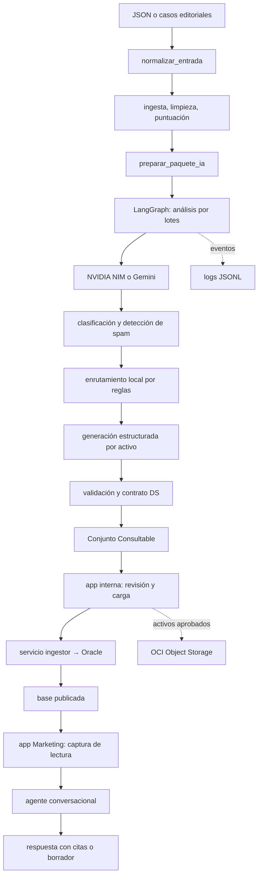

# Manual maestro de lectura del código de CommunityLab

Este documento es el manual técnico de lectura de CommunityLab. Explica cómo se
conectan las aplicaciones, la ingesta, los modelos, la conversación, la
persistencia y las pruebas; permite seguir los flujos principales desde el
archivo de entrada hasta la consulta o publicación del resultado. También
funciona como índice del código actual.

El manual está escrito en Markdown para que pueda mantenerse junto con el
código. Puede convertirse a PDF cuando se quiera distribuir una edición fija.
Si algo aquí contradice a la implementación, el código y sus pruebas son la
fuente de verdad: actualiza este documento al cambiar el comportamiento.

La meta es dar una comprensión operativa y de diseño amplia: qué
responsabilidad tiene cada módulo, qué datos recibe y produce, qué camino sigue
una solicitud y dónde están sus límites. No sustituye leer una implementación
cuando se va a modificarla. El comportamiento exacto también depende de
LangChain, LangGraph, Gemini, NVIDIA NIM, Oracle, OCI, Streamlit y la
configuración del entorno; las pruebas y el código vigente son la fuente de
verdad.

**No es una transcripción del 100% del código ni una medición de que quien lo
lea entenderá el 90%.** Referenciar todos los archivos no demuestra comprender
todos sus caminos. Este manual cubre el inventario Python completo y desarrolla
las responsabilidades, contratos, algoritmos, estados y recorridos principales;
al final de la guía de ejecución hay ejercicios para comprobar lo aprendido.
Los helpers repetitivos se agrupan por responsabilidad y las bibliotecas externas
no se explican internamente.

Su documento complementario es
[Razones de arquitectura y tecnologías](razones_arquitectura_tecnologias.md):
este manual enseña **qué ejecuta el código y cómo seguirlo**; el otro explica
**qué problema resuelve la estructura, qué cuesta y qué alternativas existen**.

### Navegación por preguntas

| Quiero entender... | Empieza aquí |
| --- | --- |
| Qué producto es y qué procesos existen | [Mapa mental](#mapa-mental) y [arquitectura vigente](#arquitectura-vigente-y-flujos) |
| Cómo cambia un mensaje desde el origen | [Recorrido de una interacción](#recorrido-de-una-interacción) y [trazabilidad de campos](#trazabilidad-de-campos-entre-capas) |
| Qué sucede al enviar una pregunta al chat | [Recorrido completo del chat](#recorrido-completo-del-chat) |
| Cómo funcionan los lotes, las citas y la revisión | [Algoritmos del contexto y la verificación](#algoritmos-del-contexto-y-la-verificación) |
| Qué vive en memoria y qué sobrevive al reinicio | [Mapa de estados y duración](#mapa-de-estados-y-duración) |
| Cómo se publica y verifica un conjunto | [Recorrido de la publicación en Oracle](#recorrido-de-la-publicación-en-oracle) |
| Cómo se guardan activos o se ejecutan plantillas | [Curaduría y catálogo diario](#curaduría-y-catálogo-diario-paso-a-paso) |
| Qué archivo tocar para un cambio | [Índice del código](#índice-del-código-procesamiento-de-datos-y-ciencia-de-datos) y [cómo modificar](#cómo-modificar-sin-romper-contratos) |
| Si realmente comprendí los flujos | [Laboratorio offline](#laboratorio-offline-de-principio-a-fin) y [autoevaluación](#autoevaluación-de-comprensión) |

## Cómo aprovecharlo

Hay tres formas de leer el proyecto:

1. **Recorrido completo:** sigue el orden de lectura propuesto y luego el
   recorrido de ejecución.
2. **Cambio puntual:** busca el archivo en el índice por responsabilidad,
   identifica su prueba y ejecuta primero esa prueba.
3. **Incidente:** busca el ID, etapa o ruta en el resultado, luego en los logs y
   finalmente en el módulo que produjo ese campo.

Esta revisión, actualizada el 2026-10-28, contrastó 81 archivos `.py` en
`src/`, 25 en `scripts/` y 99 en `tests/` (205 en total), además de los
manifiestos, contenedores, configuración y datos de referencia principales.
Los recuentos incluyen pruebas y archivos `__init__.py`; algunos `__init__.py`
solo marcan paquetes y no contienen lógica.

## Recorrido recomendado

Lee en este orden para construir el modelo mental sin saltar entre capas:

1. [README del proyecto](../README.md), [Compose](../docker-compose.yml) y
   [manifiestos de dependencias](../requirements.txt): qué se ejecuta y con
   qué componentes.
2. [Entradas de la aplicación](../src/app/app.py) y
   [aplicación interna](../src/app/app_interna.py): lanzadores que usan la
   misma UI con permisos funcionales distintos.
3. [Interfaz](../src/app/interfaz.py): páginas y estado de sesión; el flujo
   interno importa/procesa/carga y Marketing consume datos publicados.
4. [Fuente del agente](../src/app/fuente_agente.py) y
   [conversación](../src/agentes/conversacion.py): consulta de datos, filtros,
   evidencia, borradores y verificación.
5. [Preparación de datos](../src/datos/ingesta.py),
   [scoring](../src/datos/relevancia.py) y
   [Conjunto Consultable](../src/datos/conjunto_consultable.py).
6. [Grafo de análisis](../src/agentes/grafo.py), sus nodos y
   [configuración de proveedores](../src/agentes/configuracion_ia.py).
7. [Cliente de lectura](../src/config/db_client.py),
   [servicio escritor](../src/services/ingest_server.py) y adaptadores de
   guardado OCI: lectura y escritura son caminos separados.
8. Contratos, reintentos, observabilidad y evaluación, descritos abajo.
9. Suite de pruebas: distingue tests offline de integraciones que requieren
   proveedores, Oracle, OCI o red.

## Mapa mental



El diagrama resume dos ciclos: preparar/publicar datos y consultar los datos
publicados. El servicio Oracle es un escritor separado; Marketing solo lee.
Los activos pueden revisarse y guardarse en OCI Object Storage, pero el sistema
no los publica automáticamente en redes sociales. En el procesamiento de IA,
la elegibilidad de contenido y la elegibilidad FAQ son independientes del
análisis de sentimiento.

## Arquitectura vigente y flujos

### Aplicaciones y límites de acceso

`src/app/app.py` llama a `render(modo_interno=False)` y
`src/app/app_interna.py` a `render(modo_interno=True)`. Las pantallas están
centralizadas en `src/app/interfaz.py`; son dos puntos de entrada a la misma
UI, no dos aplicaciones con lógica duplicada. La interfaz interna habilita
Datos para importar, previsualizar, procesar y cargar. Marketing no expone esa
página y consume el Conjunto Consultable publicado. La variable
`COMMUNITYLAB_MODO_INTERNO` no habilita Datos en el entrypoint público.

`docker-compose.yml` define Marketing, la app interna en el perfil `interno` y
el servicio de ingesta en el perfil `ingesta`. Los Dockerfiles construyen
imágenes separadas: el frontend no incluye el servidor escritor y el servicio
de ingesta no incluye la interfaz. Los procesos corren como usuario no root;
la red de Compose es un bridge llamado `communitylab-internal` y los volúmenes
de salida de las apps se separan. El nombre de la red no impone por sí solo
aislamiento de acceso ni equivale a `internal: true`.
Las variables sensibles se inyectan al despliegue, no se guardan en el manual.

### Procesamiento y publicación de datos

En la página Datos, `entrada_interna.normalizar_entrada()` admite lotes de
interacciones o casos editoriales adaptados al esquema común. El operador
comprueba el destino del ingestor antes de procesar. El procesamiento llama a
`preparar_paquete_ia()` y `procesar_paquete_entrega()`; la UI bloquea la carga
si quedan IDs pendientes o errores de análisis.
`conjunto_consultable.construir_conjunto_consultable()` aplana resultados a
ocho campos (`id`, `canal`, `sentimiento`, `tema`, `tipo`,
`contenido_textual`, `fecha`, `autor`), ordena por ID y excluye del índice el spam
detectado, cuyo total se conserva en metadatos.

`app/carga_oracle.py` guarda una copia local identificada por hash, permite
descargar el conjunto y gestiona la confirmación del destino. Se comunica por
HTTP con el servicio privado, no abre una conexión Oracle desde Streamlit.
`services/ingest_server.py` valida el documento, verifica el entorno y destino,
y ofrece comprobación, sincronización y verificación. La escritura se hace con
`MERGE` por ID, conserva metadatos y registra huellas de carga para no contar
spam dos veces al reintentar. Es acumulativa: no borra la tabla y rechaza
conflictos de contenido para IDs existentes. Recupera la contraseña desde OCI
Vault mediante principals. Oracle/OCI no son necesarios para ejecutar los
tests unitarios.

El frontend público usa `config/db_client.py` para leer una instantánea
consistente con identidad de solo lectura. `app/fuente_agente.py` adapta las
filas al formato del agente y mantiene una captura por sesión durante una hora.
Si falla la actualización con una captura previa, esta puede seguir usándose
marcada como obsoleta; si no hay captura se informa que la fuente no está
disponible. Los archivos que sube el usuario (JSON, CSV o TXT) se limitan a la
sesión y pueden añadirse como fuente auxiliar: no se escriben en la base.

### Agente conversacional

`AgenteConversacional` en `src/agentes/conversacion.py` consulta resultados
procesados; no vuelve a ejecutar el pipeline de Ciencia de Datos. Valida
límites, estructura e IDs únicos, crea un índice y conserva un historial
acotado. El camino de cada turno es:

1. `interpretacion.py` convierte la solicitud y el historial en un
   `PlanConsulta` Pydantic: intención, términos, filtros, plataforma y
   cantidad. Rechaza combinaciones inválidas antes de la búsqueda.
2. La búsqueda local aplica filtros de tipo, sentimiento, canal, fecha y
   plataforma, además de coincidencia de términos. La selección de evidencia
   no se delega al modelo.
3. Para consultas, el modelo redacta sobre evidencia empaquetada por tokens y devuelve
   `SalidaConversacional`. El código comprueba que los IDs citados pertenezcan
   a la evidencia real.
   No se aplica el antiguo tope de 20 mensajes: se respeta la cantidad pedida
   o se usan todas las coincidencias sin cantidad, también para borradores y X.
   `contexto.py` incluye prompt, esquema, historial y datos en un presupuesto
   configurable solo en el servidor, con reserva de salida. Los textos grandes
   se fragmentan sin recortar; el flujo procesa lotes y consolida sus hallazgos
   en varios niveles si hace falta. Cada hallazgo atómico conserva sus fuentes
   específicas; la consolidación traduce solo las de los hallazgos elegidos,
   sin heredar todos los IDs de un lote. Rechaza síntesis sin esa trazabilidad.
   Los listados literales usan `campos_listado` (o `listar_autores` para nombres)
   y se calculan en Python sin redactor, conservando valores y citas.
   El `autor` nullable viaja desde Oracle a la captura y al agente.
   Las dudas no son grupos excluyentes: un mensaje puede respaldar varias,
   con IDs únicos dentro de cada grupo. El total cuenta mensajes distintos;
   las frecuencias por duda no se suman como si fueran mensajes diferentes.
4. Para borradores, `BorradorMarketing` valida plataforma, título, contenido y
   hashtags. Los estilos `preciso`, `equilibrado` y `creativo` ajustan
   temperatura/top-p. El resultado es un borrador, no una publicación.
5. La salida puede pasar por verificación estructurada de afirmaciones y
   citas, también por lotes si excede el presupuesto. Mantiene las mismas
   afirmaciones en cada lote y combina únicamente respaldos válidos. Una
   salida inválida, un lote fallido o una consolidación que no reduce el contexto
   no se trata como éxito parcial. La UI muestra cobertura y llamadas.
   `fuentes_citadas.py` presenta las referencias en páginas de diez, con
   búsqueda en todo el contenido y filtros por afirmación/duda cuando existen.
   Los textos completos solo se renderizan al solicitarlos. Navegar no llama
   al modelo ni limita la evidencia. Permite filtrar por hallazgo y fuentes
   originales; una referencia elegida por el modelo no equivale a verificación.
   La interfaz guarda una copia independiente de los datos actuales para cada
   versión de una fuente citada y comparte esa copia entre respuestas de la
   sesión mediante `fuentes_agente_versionadas`. Cambiar texto o metadatos crea
   otra versión; no altera la anterior. El explorador usa la versión del turno
   aunque después se editen o eliminen registros de la captura actual.
   Los turnos anteriores sin copia muestran un aviso de que las fuentes
   actuales podrían diferir; nunca se reconstruye una fuente histórica perdida.
   Las copias consumen memoria y no persisten entre sesiones o reinicios.
   El historial visual pagina diez turnos de pregunta/respuesta, incluidos
   errores: página 1 para los recientes y orden cronológico dentro de cada
   página. Una consulta nueva vuelve a la página 1 y cuenta dentro de los diez.
   Navegar no llama al modelo, no borra turnos ni cambia su contexto. Las
   versiones distintas y respuestas siguen creciendo en memoria; deduplicar
   y paginar no equivalen a imponer un límite total de almacenamiento.
   Para consultas analíticas generadas por IA, la revisión del texto final y
   hallazgos ahora es obligatoria: contrasta mensajes originales y agregados
   autorizados, sin confiar en los hallazgos como evidencia. Rechaza respuestas
   sin respaldo antes de guardarlas, incluso si el selector de borradores está
   desactivado. Los conteos pueden tener respaldo agregado sin IDs inventados.
   La revisión usa el mismo presupuesto y no se aplica a listados locales.
   Solo los turnos completados actualizan el último plan de búsqueda: una
   consulta fallida no cambia los filtros heredados por el siguiente turno.
6. `consumo.py` admite hasta dos consultas simultáneas por proceso y reserva
   intentos/tokens antes de cada llamada de proveedor, incluidas interpretación,
   reintentos, respaldo, correcciones y verificación. Al agotar 30 intentos o
   250000 tokens reservados por consulta, detiene el trabajo sin éxito parcial.
   La cuota horaria compartida es configurable y arranca desactivada: no hay
   techo de gasto acumulado. Varias réplicas requieren un limitador distribuido.

La conversación admite consultas, borradores, aclaraciones y respuestas fuera
de alcance. Incluye agrupación de preguntas, filtros por metadatos, resúmenes,
presupuesto de contexto y estado de último borrador para aceptar una nueva
versión. Los topes y esquemas en `conversacion.py` son parte del contrato de
seguridad y calidad; no se deben ampliar sin revisar sus pruebas.

### Proveedores, análisis y activos

`configuracion_ia.py` permite elegir proveedores separados para análisis y
generación. Los admitidos son NVIDIA NIM y Gemini; la configuración vigente
usa NVIDIA NIM por defecto y puede usar Gemini como proveedor directo o como
fallback. `modelo_ia.py` es la fachada común y
`proveedores/nvidia_nim.py` / `proveedores/gemini.py` implementan cada
adaptador. `fallback_ia.py` cambia al respaldo ante errores permitidos (por
ejemplo, timeout, cuota o salida estructurada inválida), y deja propagar
errores de entrada. Los valores de modelos se configuran por variables de
entorno.

El enrutamiento adaptativo selecciona modelos por tier: rápido para FAQ y
boletín, estándar para análisis, y razonamiento para LinkedIn, caso de éxito e
insight. No decide la elegibilidad editorial ni sustituye las reglas de
`nodo_enrutador.py`. LangGraph coordina análisis, enrutamiento determinista y
generación estructurada con esquemas Pydantic. El análisis clasifica mensajes
y detecta spam; el routing decide qué activos intentar. La concurrencia de
lotes/mensajes se configura aparte y las respuestas se correlacionan por ID,
no por posición.

### Curaduría, guardado y formatos

`curaduria_oci.py` adapta la revisión humana a los esquemas de cada activo,
comprueba el texto (incluido mojibake) y evita aprobar contenido de un
resultado distinto. `guardado.py` valida el conjunto de activos seleccionados
antes de iniciar escrituras y guarda cada aprobado en OCI Object Storage,
devolviendo por activo el resultado o fallo sin alterar la entrega de DS. Este
guardado es distinto de la carga del Conjunto Consultable a Oracle y de la
publicación en redes, que no es automática.

| Formato | Propósito | Productor/consumidor principal |
| --- | --- | --- |
| Lote de entrada | Interacciones originales o casos editoriales | `datos/ingesta.py`, `app/entrada_interna.py` |
| Paquete de procesamiento | Estados, elegibilidad, ciclos y metadatos de modelos | `datos/entrega_ia.py` |
| Entrega DS | Clasificación, activos, fallos y resumen | `agentes/entrega_resultados.py` |
| Conjunto Consultable | Contrato 1.2 de ocho campos con autor/fecha nullable para Oracle y el agente | `datos/conjunto_consultable.py` |
| Solicitud HTTP al ingestor | Confirmar destino, sincronizar y verificar una carga | `app/carga_oracle.py`, `services/ingest_server.py` |
| Activo aprobado | JSON individual guardado en OCI Object Storage | `app/guardado.py`, `config/oci_client.py` |

Algunos adaptadores aceptan versiones históricas de la entrega DS o paquetes
de auditoría. Que un consumidor acepte una versión anterior no significa que
el productor actual aún la emita; al cambiar el contrato, verificar la
constante versionada y sus pruebas.

### Configuración, secretos y ejecución

Los nombres completos y valores de ejemplo se mantienen en
[`.env.example`](../.env.example); aquí se explica qué grupo gobierna cada
comportamiento sin copiar ningún secreto:

| Grupo de variables | Propósito / consumidor |
| --- | --- |
| `COMMUNITYLAB_PROVEEDOR_ANALISIS`, `COMMUNITYLAB_PROVEEDOR_GENERACION` | Seleccionan proveedor de cada etapa. Valores admitidos: Gemini y NVIDIA NIM. |
| `COMMUNITYLAB_MODELO_GEMINI`, `COMMUNITYLAB_MODELO_NVIDIA`, `COMMUNITYLAB_MODELO_NVIDIA_*`, `COMMUNITYLAB_ENRUTAMIENTO_ADAPTATIVO` | Modelo base, modelos por tier y activación del routing adaptativo. |
| `GEMINI_API_KEY`, `NVIDIA_API_KEY`, `COMMUNITYLAB_NVIDIA_TIMEOUT_SEGUNDOS` | Credenciales del proveedor y límite de espera de NIM. Las claves solo se inyectan en el entorno del proceso que las necesita. |
| `COMMUNITYLAB_CONCURRENCIA_LOTES_ANALISIS`, `COMMUNITYLAB_CONCURRENCIA_MENSAJES` | Valores soportados 1 (secuencial) o 2 (concurrencia experimental); ajustar con pruebas de calidad y cuota. |
| `COMMUNITYLAB_CONTEXTO_TOKENS`, `COMMUNITYLAB_SALIDA_TOKENS` | Presupuesto operativo del agente: 32768 total y 4096 de salida por llamada inicialmente. Estimación conservadora de entrada por bytes UTF-8, incluyendo prompt/esquema/margen. Solo servidor, compatible con primario y respaldo; no es una cuota por visitante ni garantiza el máximo real del proveedor. |
| `COMMUNITYLAB_MAX_INTENTOS_CONSULTA`, `COMMUNITYLAB_MAX_TOKENS_CONSULTA`, `COMMUNITYLAB_MAX_CONSULTAS_ACTIVAS`, `COMMUNITYLAB_MAX_INTENTOS_HORA` | Solo servidor: 30 intentos y 250000 tokens reservados por consulta, 2 consultas simultáneas por proceso y cuota móvil horaria 0 (desactivada). Incluyen reintentos/respaldo de todas las etapas; no son límites de registros ni medición de facturación. No hay techo acumulado mientras la cuota esté desactivada. |
| `COMMUNITYLAB_LOGS`, `COMMUNITYLAB_LOG_LEVEL`, `COMMUNITYLAB_LOG_DIR` | Escritura/nivel/ruta de logs de aplicación. No se deben volcar prompts ni datos privados en logs externos. |
| `OCI_AUTH_MODE`, `OCI_CONFIG_FILE`, `OCI_CONFIG_DIR`, `OCI_PROFILE` | Identidad OCI por Instance Principals o perfil API local en `autenticacion_oci.py`. |
| `OCI_BUCKET_NAME` | Bucket destino para activos aprobados y catálogo diario. |
| `DB_READ_USER`, `DB_READ_DSN`, `DB_READ_PASSWORD_SECRET_OCID` | Identidad/DSN/secreto para que Marketing lea la base; el cliente rechaza un usuario conocido como escritor. |
| `DB_USER`, `DB_DSN`, `DB_PASSWORD_SECRET_OCID` | Identidad del ingestor que escribe en Oracle. No debe compartirse con el frontend público. |
| `INGESTOR_URL`, `INGESTOR_DESTINO`, `INGESTOR_ENTORNO`, `INGESTOR_BIND_IP` | Dirección privada del servicio y sus restricciones de destino/entorno. Ver también Compose y los tests de aislamiento. |

El frontend necesita proveedor y datos de lectura para las funciones
conversacionales; no necesita credenciales de escritura Oracle. La aplicación
interna debe desplegarse en una red/control de acceso apropiado porque permite
procesar y cargar conjuntos. Los dos procesos no deben compartir secretos de
escritura por conveniencia.

### Qué se persiste y dónde

| Dato | Destino | Quién lo escribe |
| --- | --- | --- |
| Lote preparado para reintentar una carga | Archivo local bajo `salida/ingesta/`, nombrado con SHA-256 | `app/carga_oracle.py` |
| Registros planos del conjunto | Tablas Oracle del esquema de ingesta y su tabla de metadatos/cargas | Solo `services/ingest_server.py` |
| Snapshot que consulta Marketing | Mismas tablas Oracle publicadas; lectura con rol separado | Lo actualiza el ingestor; el cliente de app solo selecciona |
| Activos editoriales aprobados | JSON por activo en OCI Object Storage | `app/guardado.py` |
| Catálogo de plantillas diarias | Un objeto versionado/condicional en OCI Object Storage | `app/plantillas_diarias.py` |
| Eventos técnicos | JSONL bajo `salida/logs/` cuando logging está habilitado | `agentes/observabilidad.py` y módulos de aplicación |

No son copias intercambiables: una carga repetida del Conjunto Consultable no
equivale a regenerar activos; el agente lee Oracle, no consulta los objetos
individuales de activos. Los nombres de objetos se construyen con segmentos
validados, y los writes del catálogo diario usan ETag para no pisar cambios
concurrentes.

## Conceptos y contratos

| Concepto | Qué significa en este código |
| --- | --- |
| Lote de Datos | Objeto con `origen_comunidad`, `periodo_referencia` e `interacciones`. El contenedor puede tener varios lotes y `metadata`. |
| Interacción | Mensaje original con ID, autor, canal, tipo preliminar, texto, fecha e idioma. |
| `tipo` / `tipo_original` | Etiqueta preliminar de Datos: `testimonio`, `pregunta_tecnica`, `comentario` o `feedback`. Se conserva para comparar; el proveedor de análisis clasifica semánticamente en otro campo. |
| `EstadoAgente` | Estado interno parcial que fluye por LangGraph. Incluye entrada, clasificación, rutas, activos y errores. |
| `ids_contenido` | Conjunto/lista de IDs habilitados para generar activos. La pertenencia por ID prevalece sobre el puntaje dentro del consumidor. |
| Ciclo de procesamiento | Grupo de IDs descrito por el plan de Datos. Puede ser mayor que una llamada del modelo; el grafo lo subdivide en lotes de hasta 10. |
| Ruta | Tipo de activo que se permite intentar: FAQ, caso de éxito, boletín, LinkedIn o insight de mejora. |
| Fallo | Registro estructurado con etapa, ID opcional, ruta opcional, tipo, mensaje, intentos y condición de reintento. |
| Contrato de salida | `EntregaCienciaDatos`, versión actual `1.4`, pensado para otras capas. Incluye estado/motivo de spam; no es el mismo objeto que el paquete de entrada de DS. |

Hay dos taxonomías que no deben confundirse: el tipo preliminar de Datos no
incluye `pregunta_programa`; la clasificación de Ciencia de Datos sí la
incluye. La elegibilidad `elegible_faq` determina si una pregunta de programa
puede convertirse en FAQ.

## Recorrido de una interacción

### 1. Entrada y validación

La entrada principal es
[mensajes_comunidad_simulados.json](../src/datos/mensajes_comunidad_simulados.json).
Cada lote identifica origen y periodo; cada interacción contiene datos del
autor y el mensaje. `validar_y_limpiar()` en `src/datos/ingesta.py` acepta un
lote individual o un contenedor `{"metadata": ..., "lotes": [...]}`.

La validación exige objetos y listas en los niveles correctos, origen y periodo
no vacíos, los campos textuales esperados y uno de los cuatro tipos
preliminares. Si existen `id`, `fecha` o `idioma`, también deben ser texto no
vacío. La función trabaja sobre una copia profunda para no mutar la entrada.

`limpiar_texto()` desescapa entidades HTML, normaliza Unicode NFC, elimina
bloques `script` y `style`, retira etiquetas HTML conocidas, reemplaza
caracteres de control y colapsa espacios. No elimina expresiones técnicas como
`a < b` o `List<T>`.

### 2. Relevancia y selección

`puntuar_interaccion()` de `src/datos/relevancia.py` es determinista. No llama
a un proveedor de IA ni accede a la red. Calcula:

- puntos por tipo, según `puntos_por_tipo`;
- puntos por longitud, proporcionales al número de palabras y limitados a 20
  palabras;
- puntos por palabras clave únicas encontradas, limitados por
  `maximo_palabras`;
- puntos de frescura si la fecha está dentro del intervalo configurado.

La suma produce `puntaje`; la salida también explica cada aporte en `desglose`,
las palabras encontradas, los `motivos` de exclusión y las `advertencias` de
fecha. Una fecha ausente, inválida o futura no suma frescura. La fecha de
referencia se recibe como argumento para que el resultado sea reproducible.

`seleccionar_lote()` agrega motivos de texto corto, solo enlaces, repetición,
contenido eliminado, duplicado y bajo umbral. Después ordena candidatos por
puntaje descendente y, en empate, por orden de entrada. `maximo_por_lote`
limita la selección y agrega `fuera_maximo_por_lote` a los candidatos que
quedan fuera.

La configuración versionada está en
[relevancia.json](../configuracion/relevancia.json). Sus valores actuales
incluyen umbral 40, un mínimo de 20 caracteres, peso de tipo variable,
frescura de 7 días y máximo sin tope (`null`). La clase
`ConfiguracionRelevancia` valida límites y pesos antes de puntuar.

### 3. Dos poblaciones, no una

`preparar_entrega()` en `src/datos/entrega_ia.py` devuelve tres elementos:

- `completos`: interacciones incluidas en el análisis de sentimiento tras
  excluir ruido de calidad explícito;
- `contenido`: mensajes que superan la selección por puntaje y límite;
- `informe`: evaluación por mensaje, decisión y configuración usada.

Para sentimiento se excluyen duplicados, texto solo con enlaces, repetición,
contenido eliminado y texto vacío. Un mensaje corto, por debajo del umbral o
fuera del máximo por lote puede seguir en sentimiento. Esto evita que la
selección de marketing distorsione la lectura general de la comunidad.

`construir_estado_agente()` traduce una interacción a `EstadoAgente`: copia
autor, canal, texto, origen, tipo original y puntaje, además de ID e idioma si
están disponibles. `construir_estados_agente()` cruza interacción e informe por
ID, valida que la población solicitada esté completa, evita duplicados y
comprueba que origen y periodo coincidan. No empareja por posición.

`construir_plan_procesamiento()` crea ciclos usando IDs. El tamaño solicitado
está entre 10 y 30. Reparte los estados en ciclos equilibrados cuando puede;
si sobran menos de 10, esos IDs pasan a `pendientes` y no se duplican.
`preparar_paquete_ia()` combina estos resultados, adjunta la configuración de
proveedor/modelo y huellas de prompts y añade `ids_contenido` al plan. Preparar
el paquete no inicializa un cliente de IA, no llama al modelo y no escribe
archivos.

### 4. Análisis por lotes

`procesar_paquete_entrega()` verifica que los IDs sean válidos y únicos, que
`ids_contenido` pertenezca a los estados y que ciclos más pendientes cubran
cada ID exactamente una vez. Procesa los ciclos en el orden del plan y devuelve
resultados, índice por ID, detalle de cada ciclo y estados pendientes.

`procesar_estados_por_lotes()` valida que el máximo por llamada esté entre 1 y
10, valida IDs únicos y subdivide el grupo. Para cada grupo llama
`analizar_lote()`. El análisis estructurado se correlaciona por ID, no por
posición: así puede corregir una respuesta cuyo orden cambie.

Si el modelo omite o duplica un ID en una respuesta válida, solo ese mensaje
cae a análisis individual. Un fallo total o una respuesta inválida del lote
queda registrado para todos los IDs del grupo; no provoca una cascada de
llamadas individuales.

Los modelos en `src/agentes/modelos.py` validan sentimientos, temas, tipos y
campos específicos de los activos mediante Pydantic. Las formas de salida no
son texto libre: `AnalisisLote` contiene resultados con ID; cada tipo de activo
tiene su propio modelo.

### 5. Enrutamiento y activos

`determinar_rutas()` en `nodo_enrutador.py` aplica reglas locales, no un segundo
LLM:

| Tipo detectado | Regla y rutas posibles |
| --- | --- |
| `pregunta_programa` | Solo FAQ si `elegible_faq` es verdadero; retorna de inmediato. |
| `pregunta_tecnica` | FAQ si no está deshabilitada por elegibilidad de contenido. |
| `feedback` | `insight_mejora` si es elegible para contenido. |
| `testimonio` | `caso_exito` y `boletin`; suma `linkedin` si sentimiento positivo o muy positivo. |
| `comentario` | No genera activo por sí solo. |

Si `elegible_contenido` es explícitamente falso, se bloquean las rutas generales.
Para estados antiguos que no traen esa decisión, se conserva un umbral de
respaldo de 40. Las preguntas de programa usan la decisión FAQ independiente.

El grafo completo (`grafo`) conecta análisis individual, enrutamiento y
generación. El grafo desde análisis (`grafo_desde_analisis`) evita repetir el
análisis cuando el estado ya fue analizado por lote. Los nodos devuelven
actualizaciones parciales del estado.

`generar_activos()` crea cada ruta independientemente. Si no hay rutas, no
inicializa el cliente del proveedor configurado. Si falla la inicialización, registra el fallo en
cada ruta; si falla una generación, intenta seguir con las demás. El modelo
transforma su salida Pydantic a diccionario. El generador agrega
`canal_recomendado` a LinkedIn y `area` a los insights; la clave técnica
`boletin` produce un `Community Highlight`.

### 6. Reintentos y recuperación

`ejecutar_con_reintentos()` en `reintentos.py` ejecuta hasta tres veces una
operación, pero solo reintenta errores transitorios: timeout, conexión, cuota,
429 y códigos 5xx conocidos. Usa backoff exponencial con jitter y tope de 30
segundos. Errores de esquema, credenciales o configuración no se repiten.

El adaptador Gemini configura sus propios límites/reintentos y NVIDIA NIM
desactiva reintentos ocultos del cliente para dejar el control a la aplicación.
El número efectivo de llamadas puede variar por proveedor y operación;
revisar `reintentos.py`, `fallback_ia.py` y el adaptador usado antes de cambiar
el límite, porque afecta costo y latencia.

Cada error definitivo se conserva en dos formas:

- `errores`: texto legible compatible con consumidores anteriores;
- `fallos`: estructura que permite filtrar por etapa, ID, ruta y
  `reintentable`.

`procesar_paquete_entrega()` hace por defecto una pasada de recuperación.
`recuperacion.py` vuelve a analizar los IDs con fallos de análisis, o regenera
solo las rutas que fallaron, preservando activos exitosos. Los errores
permanentes no se reintentan por defecto. La salida registra IDs intentados y
recuperados en `reprocesamientos`.

Para una entrega guardada, `scripts/reprocesar_fallidos.py` lee el contrato,
reconstruye la entrada de recuperación, crea una nueva salida y retorna código
1 si todavía quedan IDs reintentables. `--incluir-permanentes` amplía el
objetivo y puede repetir fallos que normalmente se consideran definitivos.

### 7. Observabilidad

`configurar_logging()` configura un archivo JSONL en
`salida/logs/ciencia_datos.jsonl`. `COMMUNITYLAB_LOGS=0` desactiva la escritura;
`COMMUNITYLAB_LOG_DIR` cambia el directorio y `COMMUNITYLAB_LOG_LEVEL` cambia el
nivel. `contexto_ejecucion()` crea un ID común para los eventos de una corrida.

`registrar_evento()` genera eventos estructurados. El formateador añade
timestamp UTC, nivel, nombre de evento y contexto. Los fallos de operación
pueden guardar traceback en el log técnico; el contrato público solo conserva
el fallo serializado. Los callbacks de LangChain registran inicio, duración,
tokens disponibles y errores de llamada. No registran el prompt ni el texto
completo del mensaje.

Para investigar un ID: busca `id_interaccion` o `ids_interaccion` en el JSONL,
identifica `etapa`, `intento` y `ruta`, y contrasta con `fallos` en la salida.
El evento `operacion_fallida` explica el agotamiento; `reprocesamiento_finalizado`
resume el resultado de recuperación.

### 8. Contrato de salida

`preparar_entrega_resultados()` valida la salida interna, verifica que los IDs
procesados no se repitan ni estén también pendientes, aplana los activos,
copia fallos e interacciones y pide a `construir_resumen_comunidad()` los
contadores. `entrega_resultados_a_json()` solo serializa a JSON UTF-8; no
escribe archivos.

`EntregaCienciaDatos` está versionado como `1.4` y contiene:

- `version_contrato` e `id_ejecucion`;
- `resumen_comunidad` con cantidades y distribuciones, incluido el total de
  spam detectado;
- `interacciones` con campos originales, análisis y estado/motivo de spam;
- `activos`, cada uno ligado a `id_interaccion`;
- `fallos`, `ids_reintentables`, `pendientes` e `ids_pendientes`.

`validacion_entrega.py` protege IDs, tipos de campos, forma de fallos y
presencia de análisis cuando no hubo errores. `resumen_entrega.py` cuenta
sentimientos, temas, tipos, elegibilidad, activos, errores y fallos. Si hay
empate de sentimientos predominantes, `sentimiento_predominante` queda en
`null` y `sentimientos_predominantes` incluye todos los empatados.

## Trazabilidad de campos entre capas

La unidad de identidad es el **ID del mensaje**, no su posición ni el autor.
Un autor puede escribir varios mensajes; una clasificación reordenada conserva
su correspondencia por ID. No mezcles las dos versiones `1.2`: una puede
referirse a un paquete histórico de auditoría y otra al Conjunto Consultable;
el nombre del contrato importa tanto como su número.

| Dato | Antes del análisis | Tras el análisis / publicación | Dentro del chat |
| --- | --- | --- | --- |
| Identidad | `id` de la interacción | `id`; los activos usan `id_interaccion` | `id` en evidencia y citas; los IDs de síntesis solo viven durante la consolidación |
| Persona | `autor` original | Se conserva o se une por ID al construir el conjunto | `autor`; vacío no se sustituye por ID como nombre |
| Texto | `texto` limpiado | `texto` en DS; `contenido_textual` en Oracle | `adaptar_conjunto()` lo devuelve como `texto` |
| Canal | `canal` / contexto de origen | `canal` plano | Se puede filtrar; no equivale a plataforma del borrador |
| Tipo | `tipo` preliminar, luego `tipo_original` | El modelo devuelve `tipo_detectado`; el conjunto lo llama `tipo` | Se adapta otra vez a `tipo_detectado` |
| Tema | No es una etiqueta humana garantizada | `tema_principal` detectado; conjunto `tema` | Se adapta a `tema_principal`; participa en búsqueda y agregados |
| Sentimiento | No lo determina el score de relevancia | `sentimiento` detectado | Filtro y distribución local; positivo incluye muy positivo |
| Fecha | `fecha` del origen cuando existe | Se une por ID; Oracle permite `null` | Se normaliza; una fecha ausente no cumple un filtro temporal |
| Elegibilidad | Reglas de Datos y `ids_contenido` | Estado interno con decisiones de contenido/FAQ | El contrato plano no transporta todo el estado editorial |
| Spam | Ruido de calidad puede salir antes de IA | `es_spam_detectado`; se excluye del índice y se contabiliza | No se reconstruyen los mensajes excluidos desde un contador |
| Resultado editorial | No existe todavía | `activos_generados` por ruta, luego `activos` aplanados | Un `borrador` del chat es otro flujo, no una fila Oracle |

El Conjunto Consultable es una **proyección**, no una copia íntegra de DS:
no incluye todos los fallos, puntajes, rutas ni activos. Si una capacidad nueva
necesita esos campos, hay que ampliar el contrato y sus consumidores; el chat
no puede recuperarlos por tener acceso a la tabla.

Productores y adaptadores:
[estado](../src/agentes/estado_agente.py),
[entrega DS](../src/agentes/entrega_resultados.py),
[proyección consultable](../src/datos/conjunto_consultable.py),
[adaptación de lectura](../src/app/fuente_agente.py).

## Recorrido completo del chat

### A. Preparar la pantalla y los datos

1. La entrada de Streamlit llama a
   [interfaz.render()](../src/app/interfaz.py). Streamlit vuelve a ejecutar
   el script al interactuar; un objeto local no sobrevive por sí solo.
2. `_datos_agente()` usa el resultado procesado en la app interna o la captura
   de Oracle en Marketing, y combina los adjuntos de la sesión.
3. [obtener_captura()](../src/app/fuente_agente.py) reutiliza datos durante una
   hora. Si vence y falla la lectura, conserva la captura previa con aviso.
   Sin captura previa el fallo se informa, no se presenta una base vacía como
   si fuera una lectura correcta. El reintento de captura fallida tiene su
   propia espera; consultar otra vez no implica golpear Oracle inmediatamente.
4. `_agente_para()` conserva la instancia en `st.session_state`. Si cambia
   la firma de los datos, `actualizar_datos()` valida e indexa la nueva base
   sin borrar la conversación.
5. El historial visible conserva las respuestas completas; la página solo
   renderiza diez turnos. Una página no es una ventana de evidencia ni el
   contexto que recibe el intérprete.

### B. Admitir, interpretar y buscar

6. El decorador [limitar_consulta](../src/agentes/consumo.py) valida límites,
   toma un cupo concurrente y crea un contador de consumo para toda la consulta.
   El `finally` libera el cupo tanto en éxito como en excepción.
7. `consultar()` valida texto, longitud, modo, plataforma/modelo seleccionable
   y parámetros de muestreo. Después pide al intérprete un
   [PlanConsulta](../src/agentes/interpretacion.py): intención, términos,
   filtros, cantidad, listado, agrupación y posible nueva versión.
8. El intérprete recibe fecha, historial reciente, plan anterior y vocabulario
   disponible. Su salida estructurada también tiene validaciones cruzadas:
   un borrador exige plataforma; no se puede pedir listado y agrupación a la
   vez; tipos alternativos y tipo singular no se combinan. Se permite una
   revisión del plan inválido; si no se obtiene un plan fiable, se informa el
   error. No hay un parser por palabras clave como sustituto silencioso.
9. Conversación, aclaración y fuera de alcance devuelven la respuesta del plan
   sin buscar mensajes. Las otras intenciones construyen `FiltrosConsulta`.
10. `_buscar()` normaliza tokens y consulta un índice invertido
    `token -> índices de mensajes`. Los términos se unen como candidatos:
    basta coincidir con uno; más coincidencias dan más puntaje. Después aplica
    filtros. Sin términos, todos los mensajes son candidatos antes de filtrar.
    No son embeddings ni SQL generado; no garantiza encontrar sinónimos que
    el intérprete no tradujo a palabras presentes.
11. Los filtros de tipo alternativo son OR; sentimiento, canal y fechas se
    combinan con el resto. Positivo/negativo incluyen sus variantes intensas.
    Ordena por coincidencias, preferencia por muy positivo y orden de entrada.
    Esa preferencia no es una demostración de calidad editorial.

### C. Resolver según la intención

12. Sin coincidencias, genera una explicación local, con motivos y valores
    disponibles. No llama al redactor ni inventa evidencia.
13. `_resumir()` calcula sobre **todos los encontrados** los conteos de
    sentimiento, tipo, canal y tema, con porcentajes redondeados a un decimal.
    `universo_total` describe la base de la sesión; `total_coincidencias`,
    los encontrados; `cantidad_solicitada`, una petición de selección.
    No son tres formas de nombrar el mismo número.
14. Un listado literal se resuelve en Python. Los autores se deduplican por
    nombre normalizado y conservan un ID de respaldo por nombre; no equivalen
    a un padrón de personas verificado. Listados de un solo metadato pueden
    deduplicar valores; listar contenido o ID conserva registros. El intérprete
    sí puede haber consumido una llamada aunque no haya redactor.
15. Para análisis/borradores, `encontrados[:cantidad]` selecciona la evidencia.
    Con cantidad `None` usa todas las coincidencias, sin el antiguo tope 20.
    Los agregados siguen siendo del conjunto filtrado entero: pedir cinco
    ejemplos no recalcula la distribución con esos cinco.
16. `_generar()` usa una llamada si todo cabe o extracción/consolidación por
    tokens. Devuelve un `SalidaConversacional`, no solamente una cadena.
    Un borrador viaja en un objeto con plataforma, título, contenido y hashtags.
17. Se validan fuentes, formato, copias literales y restricciones editoriales.
    Para X se verifica el texto de publicación con hashtags contra 280
    caracteres. Cambiar tono no autoriza cambiar hechos. Una nueva propuesta
    lleva control contra el título/contenido anterior.
18. Para preguntas agrupadas la aplicación calcula cantidades desde los IDs
    de cada grupo y compone el texto presentado; no confía en un conteo libre
    del modelo. Un mensaje puede aparecer en distintas dudas.

### D. Verificar, confirmar y presentar

19. Todo análisis generado pasa por `_verificar_analisis()`, contra originales
    y agregados autorizados. Un borrador solo usa el ciclo de revisión factual
    si su modo es automático; si falla, intenta una corrección y vuelve a
    verificarla. El modo estricto del borrador no significa verificación
    independiente.
20. Solo al terminar los controles se guarda el turno y se cambia
    `_ultimo_plan`; `_ultimo_borrador` cambia si hay borrador. Una excepción no
    convierte el intento fallido en contexto de búsqueda exitoso.
21. La UI captura las fuentes citadas antes de guardar su respuesta visible.
    [conservar_fuentes()](../src/app/fuentes_citadas.py) reutiliza la misma
    copia si ID, texto y metadatos son iguales; de otro modo conserva otra
    versión. El origen puede actualizarse sin alterar respuestas anteriores.
22. La respuesta muestra consumo, cobertura, borrador, revisión y fuentes según
    corresponda. Los controles de publicación preparan texto/enlaces; no
    acreditan que una red social haya publicado nada.

### Lectura de la salida sin confundir campos

| Campo | Qué prueba / qué no prueba |
| --- | --- |
| `respuesta` | Texto mostrado; no demuestra por sí solo que se consultó toda la base |
| `citas` | IDs de respaldo; tener ID permitido no prueba respaldo semántico |
| `hallazgos` | Hechos atómicos y procedencia registrada; no son fuentes originales |
| `grupos_preguntas` | Dudas y mensajes asociados; sus grupos pueden solaparse |
| `resumen.procesamiento` | Registros y etapas procesadas; cobertura no significa ausencia de omisiones en el resumen |
| `verificacion` | Resultado de otra comprobación por modelo; no prueba formal de verdad ni exhaustividad |
| `consumo` | Intentos y reservas conservadoras; no factura ni tokens exactos del proveedor |
| `fuentes_citadas` | Versión histórica agregada por la UI al chat guardado; no la devuelve necesariamente todo consumidor de `consultar()` |

## Algoritmos del contexto y la verificación

### Empaquetar sin cortar la evidencia seleccionada

[contexto.py](../src/agentes/contexto.py) recibe una función `cabe(fuentes)`
que incluye instrucciones, historial, agregados, esquema y reserva de salida.
No divide simplemente la lista cada N mensajes:

1. Comprueba que incluso el contexto vacío quepa; si no, falla explícitamente.
2. Añade el siguiente registro si cabe en el lote actual.
3. Si no cabe pero el lote tiene elementos, cierra ese lote y reintenta el
   mismo registro en otro vacío.
4. Si el registro solo tampoco cabe, divide su `texto` a la mitad, manteniendo
   ID y metadatos, y procesa ambas mitades en orden.
5. Repite hasta empaquetar todo o detectar que ni un fragmento mínimo cabe.

La fragmentación opera sobre caracteres Python, no bytes partidos a mitad
de un carácter Unicode. Mantener el ID permite volver al mensaje original.
Este algoritmo no recupera lo que ya se perdió antes de entrar al agente.
En particular, el lector de adjuntos recorta cada texto al máximo de 50.000
caracteres: **la ausencia de recorte durante el empaquetado no implica ausencia
de límites en la importación**.

### Consolidar y conservar procedencia

[conversacion._generar()](../src/agentes/conversacion.py) empieza con
`procedencia[id] = [id]`. En cada lote obtiene hallazgos atómicos o dudas.
Cada nota se convierte en evidencia intermedia con ID `sintesis-nivel-indice`.
El mapa relaciona ese ID solo con las fuentes que respaldaban esa nota.

Si las notas todavía no caben, se consolidan en otro nivel. Si no disminuyen
el contexto y sigue sin caber, se interrumpe en vez de entrar en un bucle.
Al devolver la salida final se expanden los IDs intermedios a originales y se
deduplican; el usuario no debe ver referencias inventadas de síntesis.

Procesar todos los textos no garantiza que el extractor retenga cada detalle.
Para «lista todos los textos» usa el camino literal, no una síntesis generativa.

### Revisar afirmaciones, no simplemente revisar IDs

[prompts/verificacion.py](../src/agentes/prompts/verificacion.py) exige revisar
el texto final completo, no asumir que sus hallazgos ya lo justifican.
La aplicación suministra originales y una lista permitida de agregados.
Una afirmación aceptada necesita respaldo declarado y citas válidas o respaldo
agregado autorizado; la marca de agregado no valida un borrador.

Si no cabe la revisión completa, primero se extraen afirmaciones del candidato
sin mensajes; luego se evalúan exactamente esas afirmaciones contra cada lote,
con los mismos agregados. Rechaza cambios en la lista de afirmaciones y citas
ajenas al lote. Combina los respaldos encontrados, no promedia opiniones.
Una afirmación que exige unir fragmentos puede quedar sin comprobar: se prefiere
rechazarla a presentar respaldo inexistente. Una extracción incompleta sigue
siendo un límite semántico del modelo, no algo que Pydantic pueda probar.

### Presupuesto por llamada frente a presupuesto por consulta

Con los valores iniciales, una llamada dispone de 32.768 unidades estimadas
totales menos 4.096 reservadas para salida. `estimar_tokens()` cuenta bytes
UTF-8 de texto/JSON; no utiliza el tokenizador real. El cálculo de entrada
añade esquema y margen. El redactor no recibe el total como texto disponible.

El contador de [consumo.py](../src/agentes/consumo.py) suma reservas antes de
cada intento real; una consulta puede tener interpretación, varios lotes,
consolidación, revisión, reintentos y fallback. Los intentos fallidos no
devuelven la reserva. Con 30 intentos o 250.000 unidades se detiene la consulta,
sin entregar una respuesta parcial como válida.

`ContextVar` asocia el contador a la ejecución; `Lock` protege admisión y cuota
del proceso; `monotonic()` mide la ventana horaria. No forman una cuota
distribuida. El control de conversación no debe confundirse con los ciclos
del pipeline DS ni con la facturación de un proveedor externo.

### Límites que todavía existen y qué significan

Quitar el tope de evidencia de 20 no eliminó las barreras de entrada ni la
reserva de salida. Son mecanismos con propósitos distintos:

| Límite vigente | Dónde / efecto |
| --- | --- |
| 50.000 mensajes y 5.000.000 caracteres de texto por dataset del agente | `_extraer_mensajes()` rechaza excedentes; no selecciona en silencio los primeros |
| 50.000 caracteres por mensaje del agente | El agente rechaza textos mayores; el lector de adjuntos recorta a ese tamaño antes de entregarlos |
| 5 MiB por adjunto y 5.000 mensajes por archivo | `leer_archivo_usuario()` valida tamaño/cantidad; no es el número máximo de coincidencias de una consulta |
| 1.000 caracteres de consulta | `consultar()` rechaza la petición larga antes de interpretarla |
| Hasta 12 términos de búsqueda y 32 tipos alternativos en el plan | Restricciones de `PlanConsulta`, no un límite al número de registros |
| Vocabulario de 32 valores por sentimiento/tipo/canal | `_indexar()` limita la guía enviada al intérprete; la base y los filtros no se reducen a esos 32 mensajes |
| Contexto y salida por llamada | `contexto.py`; pueden requerir lotes o causar rechazo si ni instrucciones y esquema caben |
| Intentos y reservas por consulta | `consumo.py`; pueden impedir completar una consulta aunque todos sus registros sean válidos |

Estos números describen esta implementación, no cuotas oficiales del
proveedor. Al ajustarlos, revisar productor, consumidor, UI y pruebas, no
solamente cambiar una constante.

## Mapa de estados y duración

| Estado | Propietario y duración | Cuándo cambia / límite |
| --- | --- | --- |
| Datos originales, paquete y entrega DS | Variables/resultados de una corrida; archivos solo al exportar | No son la tabla publicada hasta completar la carga |
| Tablas y recibos de carga | Oracle, durable según su administración | Transacción del ingestor; no se reinician al refrescar UI |
| `captura_base_comunidad` | Sesión Streamlit | Expira tras una hora; puede quedar obsoleta con aviso |
| `archivos_usuario` | Sesión Streamlit | Alta/baja de adjuntos; no se cargan a Oracle |
| `_mensajes`, índice y vocabulario | Instancia de `AgenteConversacional` | Se reconstruyen al actualizar datos |
| `_historial` | Instancia del agente | Retiene hasta 12 mensajes internos; se usan los últimos 6 en los prompts y cada respuesta guardada se limita a 4.000 caracteres |
| `_ultimo_plan`, `_ultimo_borrador` | Instancia del agente | Última consulta completada / último borrador; no son un historial persistente |
| `historial_agente` | Sesión UI | Respuestas completas y errores; no se recorta al paginar |
| `fuentes_agente_versionadas` | Sesión UI | Una copia por ID y versión exacta; se trata como solo lectura |
| `pagina_historial_agente` | Sesión UI | Cambia al navegar; nueva consulta vuelve a 1 |
| Cupos y ventana horaria | Variables del proceso en `consumo.py` | Compartidos entre sesiones del proceso; no entre réplicas ni reinicios |
| Catálogo diario | Objeto OCI | Reemplazo condicional por ETag; no es el historial privado del chat |
| Ediciones, aprobaciones y recibos | Contexto de curaduría de sesión | Se invalidan al cambiar el objeto de resultado |

**Tres números diferentes:** seis mensajes recientes de contexto, diez turnos
por página de historial y diez fuentes por página de citas. Ninguno limita a
diez los mensajes que se pueden analizar. La deduplicación evita copiar de
nuevo una fuente igual, pero no impone un máximo de memoria si crecen las
respuestas o las versiones distintas.

## Recorrido de la publicación en Oracle

Sigue [carga_oracle.py](../src/app/carga_oracle.py),
[ingest_server.py](../src/services/ingest_server.py) y
[db_client.py](../src/config/db_client.py). Este camino no es el guardado de
activos en Object Storage.

1. La UI construye el conjunto, conserva el JSON local por huella y comprueba
   `/destino`. La identidad del destino es un hash; no es una contraseña.
2. El operador confirma destino/entorno. La UI envía JSON y los encabezados
   de confirmación correspondientes. Si el destino cambió, se debe confirmar
   de nuevo; los datos sintéticos con esa marca requieren demostración.
3. El servidor valida versión, campos, tipos y registros antes de escribir.
   El contrato actual permite `fecha` y `autor` nulos, no todos los campos.
4. `_publicar_lote()` exige conexión exclusiva sin autocommit ni transacción
   activa. Bloquea tablas de datos, metadatos y recibos con `NOWAIT`.
5. Lee filas/metadatos existentes y compara por ID. Mismo ID con contenido
   distinto es conflicto, no una autorización para editar la fila.
6. Calcula la huella del lote y consulta su recibo. Inserta solo filas nuevas
   mediante el `MERGE` y parámetros enlazados; registra metadatos y recibo.
   Un reintento idéntico no vuelve a sumar el spam del lote.
7. Si se solapan lotes sin recibo y con contador de spam, rechaza la ambigüedad
   en lugar de sumar dos veces. Versiones antiguas conservan su compatibilidad
   de campos/huellas; no borran autores enriquecidos con cargas nuevas.
8. Solo entonces hace `commit()`. Cualquier excepción provoca `rollback()`.
   No hay una transacción que englobe proveedores externos y Oracle.
9. `/verificar` compara las filas esperadas con las guardadas: devuelve
   faltantes y diferentes. Confirmar envío HTTP no equivale a verificar datos.
10. Marketing hace un único `SELECT` que reúne metadatos y registros, convierte
    CLOB a texto, comprueba el total y expone el contrato actual. No necesita
    una llamada por mensaje ni escribe un commit.

### Leer los endpoints correctamente

| Endpoint | Efecto / fallos relevantes |
| --- | --- |
| `GET /health` | Confirma que responde HTTP; no demuestra acceso a Oracle |
| `GET /destino` | Comprueba Oracle e identidad/entorno; devuelve 503 si no logra comprobarlos |
| `POST /sincronizar` | Valida y carga acumulativamente; 400 por validación y 500 por fallo interno |
| `POST /verificar` | Solo compara el conjunto enviado; un HTTP 200 puede contener `verificado=false` |

Los encabezados de destino no sustituyen autenticación ni una red privada.
El nombre `instantanea_completa` no significa «borrar todo y reemplazar»:
la implementación vigente es acumulativa, conserva registros anteriores y
rechaza conflictos. No ejecutes una carga de prueba contra producción.

## Curaduría y catálogo diario paso a paso

### Un activo del pipeline que revisa una persona

1. [contexto_curaduria()](../src/app/curaduria_oci.py) liga aprobaciones a una
   salida concreta. Un resultado nuevo no hereda aprobaciones del anterior.
2. La persona edita; el adaptador valida campos, esquema y codificación.
   Reparar mojibake es una acción explícita: no debe cambiar silenciosamente
   el texto que se aprobó.
3. `guardar_curaduria()` hace una copia del resultado y reemplaza solo los
   activos seleccionados, identificados por `(id_interaccion, tipo)`.
4. [guardar_resultado_aprobado()](../src/app/guardado.py) comprueba todas las
   selecciones, nombres y JSON antes de la primera escritura.
5. El SDK síncrono trabaja secuencialmente en un hilo mediante el puente
   asíncrono. Registra por activo guardado/fallido/omitido; no promete que un
   lote de objetos sea una transacción atómica.
6. [oci_client.py](../src/config/oci_client.py) sube JSON al bucket. Este
   resultado es persistencia, no publicación automática en LinkedIn o X.

### Una plantilla del catálogo diario

1. [generar_plantillas_diarias.py](../scripts/generar_plantillas_diarias.py)
   ejecuta la actualización; la condición de fecha está en
   [plantillas_diarias.py](../src/app/plantillas_diarias.py). La hora de código
   es 13:00 UTC. Definirla no instala por sí mismo un scheduler externo.
2. El repositorio lee un único objeto y su ETag. Ausencia del objeto permite
   creación; errores de permisos o red no se convierten en catálogo vacío.
3. Se determinan pendientes: entrada ausente, de otra fecha o con prompt
   cambiado. Un éxito vigente no se regenera sin necesidad.
4. Se lee una captura para ese intento. Cada plantilla pendiente usa una
   instancia nueva del agente, sin heredar la conversación de otra plantilla.
5. Se valida plataforma, forma de salida y condiciones especiales como titular
   y máximo de palabras del boletín. Si falla una plantilla, se registra el
   fallo y pueden conservarse entradas anteriores con sus fechas.
6. Un `PUT` reemplaza el documento con `if_match` del ETag leído o
   `if_none_match="*"` si era creación. Un conflicto de concurrencia se propaga;
   no se anuncia un catálogo guardado si otro escritor ganó.

El catálogo, los activos curados y las fuentes históricas del chat son tres
usos diferentes de almacenamiento. Que el chat preserve fuentes en sesión no
convierte todas las entradas del catálogo OCI en instantáneas de evidencia.

## Evaluación: qué demuestra y qué no

`src/evaluacion.py` calcula coincidencia exacta para sentimiento, tema, tipo y
rutas. También produce métricas por clase y matrices de confusión. Las rutas
son multilabel y se miden por ruta como clasificación binaria. Una predicción
ausente se cuenta como `<sin_prediccion>` en las métricas por clase; IDs
inesperados generan discrepancias y bloquean la aprobación. Los umbrales están
en `UMBRALES_MINIMOS`.

`evaluar_rutas_referencia()` compara rutas históricas con el enrutador
determinista actual. `evaluacion_aprobada()` falla si hay IDs inesperados o si
alguna métrica no llega al umbral. `scripts/evaluar_casos_ambiguos.py` conserva
la carga de snapshots, salida de consola y modo opcional en vivo. El modo
predeterminado es offline; `--en-vivo` llama al proveedor de análisis
seleccionado en la configuración.

Las evidencias JSON son ejecuciones guardadas, no una verdad humana aprobada.
El conjunto candidato `tests/fixtures/casos_referencia_ia_candidatos.json`
declara explícitamente que está pendiente de revisión. Una métrica de acuerdo
con un snapshot mide estabilidad frente a esa ejecución, no exactitud semántica
absoluta.

## Índice del código: procesamiento de Datos y Ciencia de Datos

### `src/`: código de producto

#### Datos

| Archivo | Qué hace y qué leer dentro |
| --- | --- |
| [src/datos/ingesta.py](../src/datos/ingesta.py) | Puerta de entrada de Datos. Contiene limpieza, validación del esquema, `procesar_datos`, adaptación a `EstadoAgente`, cruce por ID, proyección del contrato de entrada, fragmentos por lote, guardado seguro con manifiesto y CLI. |
| [src/datos/relevancia.py](../src/datos/relevancia.py) | Configuración validada, fechas ISO con zona horaria, normalización de comparación, score determinista y selección estable por lote. |
| [src/datos/entrega_ia.py](../src/datos/entrega_ia.py) | Filtra ruido de sentimiento, arma estados, valida identidad/contexto, calcula el plan y añade modelo y huellas de prompts al informe. No invoca IA. |
| [src/datos/ingesta_reddit.py](../src/datos/ingesta_reddit.py) | Adaptador RSS/Atom. Separa parsing y transformación testeables de descarga HTTP, rate limit, pausa, guardado y CLI. Elimina comentarios borrados. |

#### Agente y contrato

| Archivo | Qué hace y qué leer dentro |
| --- | --- |
| [src/agentes/estado_agente.py](../src/agentes/estado_agente.py) | Tipo `TypedDict` del estado interno, rutas permitidas y campos opcionales/requeridos. Es el vocabulario que comparten los nodos. |
| [src/agentes/modelos.py](../src/agentes/modelos.py) | Enumeraciones literales y modelos Pydantic para análisis individual, análisis por lote e outputs de cada activo. Cambiar aquí altera validación de respuestas del modelo. |
| [src/agentes/modelo_ia.py](../src/agentes/modelo_ia.py) | Fachada de proveedores para obtener modelos estructurados y aplicar fallback; no es el único proveedor. |
| [src/agentes/cadenas.py](../src/agentes/cadenas.py) | Combina prompts de análisis con structured output y los expone como `RunnableLambda`; propaga `RunnableConfig`. |
| [src/agentes/grafo.py](../src/agentes/grafo.py) | Define nodos, transiciones condicionales, grafos completo y desde análisis, límite de 10 y `procesar_estados_por_lotes()`. |
| [src/agentes/procesamiento.py](../src/agentes/procesamiento.py) | Valida coherencia del paquete, ejecuta los ciclos por ID, devuelve pendientes, crea contexto de logging y coordina recuperación final. |
| [src/agentes/recuperacion.py](../src/agentes/recuperacion.py) | Selecciona fallos reintentables, reconstruye estado para reanálisis o regenera solo rutas fallidas; actualiza índices/ciclos y expone `reprocesar_fallidos()`. |
| [src/agentes/reintentos.py](../src/agentes/reintentos.py) | Clasificación transitoria, backoff, excepción `FalloOperacion`, fallos serializables y descripción legible. |
| [src/agentes/observabilidad.py](../src/agentes/observabilidad.py) | Logging JSONL, contexto de ejecución, extracción de uso de tokens, callback LangChain y metadata de ejecución. |
| [src/agentes/contrato_salida_ciencia_datos.py](../src/agentes/contrato_salida_ciencia_datos.py) | Tipos `TypedDict` del contrato externo DS 1.4: resumen, interacción, activo y entrega, incluido spam. No ejecuta procesamiento. |
| [src/agentes/validacion_entrega.py](../src/agentes/validacion_entrega.py) | Comprueba estructura y unicidad de resultados antes de construir el contrato. |
| [src/agentes/resumen_entrega.py](../src/agentes/resumen_entrega.py) | Calcula distribuciones, conteos, fallos por etapa y sentimientos/temas predominantes. |
| [src/agentes/entrega_resultados.py](../src/agentes/entrega_resultados.py) | Convierte estado interno a contrato público, aplana activos y serializa JSON. |
| [src/agentes/trazabilidad_prompts.py](../src/agentes/trazabilidad_prompts.py) | Canonicaliza cada ChatPromptTemplate y genera hash SHA-256 individual y global. |
| [src/agentes/__init__.py](../src/agentes/__init__.py) | Archivo vacío que marca el paquete Python; no reexporta símbolos. |

#### Nodos y prompts

| Archivo | Qué hace y qué leer dentro |
| --- | --- |
| [src/agentes/nodos/nodo_analizador.py](../src/agentes/nodos/nodo_analizador.py) | Construye entradas de análisis, valida respuestas, registra fallos y reintenta lote/individual. Correlaciona resultados por ID y resuelve omisiones/duplicados. |
| [src/agentes/nodos/nodo_enrutador.py](../src/agentes/nodos/nodo_enrutador.py) | Aplica las reglas de elegibilidad y tipo para producir una o varias rutas, sin invocar Gemini. |
| [src/agentes/nodos/nodos_generadores.py](../src/agentes/nodos/nodos_generadores.py) | Mapea las cinco rutas a cadenas/modelos Pydantic, genera independientemente por ruta y preserva resultados ante fallos parciales. |
| [src/agentes/nodos/__init__.py](../src/agentes/nodos/__init__.py) | Archivo vacío de paquete; no registra nodos ni exporta funciones. |
| [src/agentes/prompts/analisis.py](../src/agentes/prompts/analisis.py) | Prompt individual y variante por lote. Define clases de sentimiento, temas, tipos y reglas para separar preguntas técnicas/programa y feedback/comentarios. |
| [src/agentes/prompts/linkedin.py](../src/agentes/prompts/linkedin.py) | Prompt institucional para título, contenido y hashtags; insiste en atribución, fidelidad y no inventar causalidad. |
| [src/agentes/prompts/boletin.py](../src/agentes/prompts/boletin.py) | Prompt de `Community Highlight`: sección, titular y resumen breve verificable. |
| [src/agentes/prompts/preguntas_frecuentes.py](../src/agentes/prompts/preguntas_frecuentes.py) | Prompt de FAQ técnica o de programa; respuestas prudentes y sin inventar políticas/precios/fechas institucionales. |
| [src/agentes/prompts/caso_exito.py](../src/agentes/prompts/caso_exito.py) | Prompt de titular y resumen factual de caso de éxito, separando hechos de percepción y causalidad. |
| [src/agentes/prompts/insight_mejora.py](../src/agentes/prompts/insight_mejora.py) | Prompt de hallazgo interno; solo propone `sugerencia_detectada` si el mensaje expresa una sugerencia. |
| [src/agentes/prompts/__init__.py](../src/agentes/prompts/__init__.py) | Solo contiene el docstring que describe el paquete de prompts. |

#### Evaluación e interfaz

| Archivo | Qué hace y qué leer dentro |
| --- | --- |
| [src/evaluacion.py](../src/evaluacion.py) | Métricas globales y por clase, matrices de confusión, comparación de rutas con reglas y aprobación según umbrales. |
| [src/app/app.py](../src/app/app.py) | Entry point Streamlit de Marketing; delega el render a `interfaz.render(modo_interno=False)`. |
| [src/__init__.py](../src/__init__.py) | Archivo vacío que marca `src` como paquete. |

#### Módulos actuales de aplicación, nube y ampliaciones de Datos/IA

Los módulos anteriores describen el núcleo original. Esta tabla documenta las
responsabilidades que ampliaron el producto; junto con las tablas previas,
cubre los módulos Python de `src/` en este inventario.

| Archivo | Responsabilidad |
| --- | --- |
| [src/datos/casos_editoriales.py](../src/datos/casos_editoriales.py) | Adapta casos editoriales al esquema de lotes; marca metadatos ausentes y no convierte las etiquetas propuestas en predicciones. Su CLI prepara datos, no ejecuta IA. |
| [src/datos/ciclos_transporte.py](../src/datos/ciclos_transporte.py) | Exporta fragmentos con el contrato intermedio de ingesta, valida nombres/rutas y administra manifiesto seguro dentro de `salida/`. Es transporte, no los ciclos operativos de `entrega_ia.py`. |
| [src/datos/conjunto_consultable.py](../src/datos/conjunto_consultable.py) | Aplana una entrega DS a un índice 1.2 de ocho campos, une fecha/autor por ID, excluye spam y emite JSON versionado para Oracle. |
| [src/datos/limpieza.py](../src/datos/limpieza.py) | Saneamiento de texto compartido y detección/reparación controlada de mojibake. |
| [src/datos/metadatos.py](../src/datos/metadatos.py) | Convenciones de metadatos ausentes y su exposición segura a consumidores. |
| [src/agentes/auditoria_semana4.py](../src/agentes/auditoria_semana4.py) | Utilidades para auditoría/consistencia de resultados y snapshots, separadas del procesamiento normal. |
| [src/agentes/configuracion_ia.py](../src/agentes/configuracion_ia.py) | Proveedores de análisis/generación, modelos, tiers adaptativos, concurrencia y opciones operativas del entorno. |
| [src/agentes/contexto.py](../src/agentes/contexto.py) | Valida presupuesto total/reserva desde entorno, estima entrada conservadoramente y empaca o fragmenta evidencia sin descartar registros ni caracteres. |
| [src/agentes/consumo.py](../src/agentes/consumo.py) | Presupuesto total por consulta con ContextVar, admisión concurrente y cuota horaria opcional compartidas por proceso. Reserva cada intento antes del proveedor y libera cupos ante fallos; no es un contador distribuido ni de facturación real. |
| [src/app/fuentes_citadas.py](../src/app/fuentes_citadas.py) | Explorador de referencias con búsqueda, diez fuentes por página, filtro por afirmación/duda y texto completo bajo demanda. Conserva IDs ausentes con aviso; no vuelve a ejecutar IA. |
| [src/agentes/conversacion.py](../src/agentes/conversacion.py) | Agente conversacional: validación e indexación de datos, consulta con evidencia/citas, borradores, preguntas agrupadas, verificación e historial. |
| [src/agentes/errores_ia.py](../src/agentes/errores_ia.py) | Excepciones comunes de configuración, salida inválida y fallback de proveedores. |
| [src/agentes/fallback_ia.py](../src/agentes/fallback_ia.py) | Clasifica errores aptos para cambiar de proveedor y genera una traza segura del fallback. |
| [src/agentes/huellas.py](../src/agentes/huellas.py) | Calcula SHA-256 de archivos con normalización CRLF→LF para huellas reproducibles entre Windows y Unix. |
| [src/agentes/interpretacion.py](../src/agentes/interpretacion.py) | Convierte lenguaje natural en un `PlanConsulta` Pydantic validado. |
| [src/agentes/plataformas.py](../src/agentes/plataformas.py) | Vocabulario de plataformas y transformación de contenido para su presentación. |
| [src/agentes/proveedores/gemini.py](../src/agentes/proveedores/gemini.py) | Adaptador Gemini, modelos estructurados, configuración y límites/rate limit del cliente. |
| [src/agentes/proveedores/nvidia_nim.py](../src/agentes/proveedores/nvidia_nim.py) | Adaptador NVIDIA NIM compatible con LangChain, configuración de modelo y salida estructurada. |
| [src/agentes/prompts/conversacion.py](../src/agentes/prompts/conversacion.py) | Instrucciones de respuesta basadas en evidencia seleccionada por código. |
| [src/agentes/prompts/interpretacion.py](../src/agentes/prompts/interpretacion.py) | Instrucciones para traducir una solicitud/historial a intención y filtros. |
| [src/agentes/prompts/verificacion.py](../src/agentes/prompts/verificacion.py) | Instrucciones para contrastar afirmaciones con evidencia y citas. |
| [src/app/app_interna.py](../src/app/app_interna.py) | Entry point del equipo técnico; llama a `render(modo_interno=True)`. |
| [src/app/interfaz.py](../src/app/interfaz.py) | Orquesta páginas Streamlit, navegación/session state, ingestión interna, análisis, agente, vistas y curaduría. |
| [src/app/entrada_interna.py](../src/app/entrada_interna.py) | Validación y normalización inicial del JSON importado por Datos. |
| [src/app/carga_oracle.py](../src/app/carga_oracle.py) | Copia local idempotente y cliente HTTP del servicio privado; no abre conexión Oracle desde la UI. |
| [src/app/fuente_agente.py](../src/app/fuente_agente.py) | Lee y adapta el conjunto publicado, controla captura de sesión y adjuntos JSON/CSV/TXT. |
| [src/app/curaduria_oci.py](../src/app/curaduria_oci.py) | Validación de activos editados, reparación de codificación y aprobación limitada a la salida actual. |
| [src/app/guardado.py](../src/app/guardado.py) | Persistencia en OCI Object Storage de los activos aprobados, con informe por guardado/fallo/omisión. |
| [src/app/errores_agente.py](../src/app/errores_agente.py) | Traduce excepciones internas a mensajes destinados a la interfaz. |
| [src/app/estilo_agente.py](../src/app/estilo_agente.py) | Componentes de estilo/presentación del área conversacional. |
| [src/app/horas.py](../src/app/horas.py) | Formato y presentación de información horaria en la UI. |
| [src/app/plantillas_catalogo.py](../src/app/plantillas_catalogo.py) | Catálogo y selección de plantillas de contenido. |
| [src/app/plantillas_diarias.py](../src/app/plantillas_diarias.py) | Define catálogo diario, ejecuta prompts aislados sobre una captura de datos y conserva/reemplaza parcialmente un objeto en OCI con ETag. |
| [src/app/publicacion_redes.py](../src/app/publicacion_redes.py) | Adaptación del texto a redes/plataformas; no implementa envío automático. |
| [src/app/tema.py](../src/app/tema.py) | Identidad visual, colores, logotipo y estilo global. |
| [src/app/vista_analiticas.py](../src/app/vista_analiticas.py) | Componentes de visualización de analíticas. |
| [src/app/vista_ayuda.py](../src/app/vista_ayuda.py) | Vista de ayuda y contenido contextual. |
| [src/app/vista_inicio.py](../src/app/vista_inicio.py) | Vista inicial y componentes de inicio. |
| [src/app/vista_plantillas.py](../src/app/vista_plantillas.py) | Vista de revisión/edición de activos generados. |
| [src/app/vista_plantillas_diarias.py](../src/app/vista_plantillas_diarias.py) | Vista de plantillas editoriales diarias. |
| [src/config/autenticacion_oci.py](../src/config/autenticacion_oci.py) | Autenticación OCI por Instance Principals o API key/perfil local seleccionado. |
| [src/config/db_client.py](../src/config/db_client.py) | Cliente Oracle de solo lectura: obtiene contraseña desde Vault y consulta el Conjunto Consultable. |
| [src/config/oci_client.py](../src/config/oci_client.py) | Cliente Object Storage, validación de nombres de objeto y subida JSON. |
| [src/config/protocolo_db.py](../src/config/protocolo_db.py) | Protocolo tipado de conexión/cursor para inyección y pruebas aisladas. |
| [src/services/ingest_server.py](../src/services/ingest_server.py) | Servicio HTTP interno para validar destino/lotes, sincronizar registros y verificar persistencia en Oracle. |
| [src/services/__init__.py](../src/services/__init__.py) | Marca el paquete de servicios. |
| [src/config/__init__.py](../src/config/__init__.py) | Marca el paquete de conectores de infraestructura. |
| [src/agentes/proveedores/__init__.py](../src/agentes/proveedores/__init__.py) | Marca el paquete de adaptadores de proveedor. |
| [src/app/assets/](../src/app/assets/) | SVG locales de identidad e iconos de plataformas; son recursos de UI, no lógica de publicación. |

### `scripts/`: ejemplos y operaciones

| Archivo | Para qué sirve y cuándo ejecutarlo |
| --- | --- |
| [scripts/apoyo_demostraciones.py](../scripts/apoyo_demostraciones.py) | Comparte la carga del dataset, el armado de paquete demostrativo, elección de fecha de referencia y mapa de evaluaciones por ID. |
| [scripts/demostracion_analisis_sin_contenido.py](../scripts/demostracion_analisis_sin_contenido.py) | Caso `int-008`: demuestra que un mensaje puede alimentar sentimiento aunque no alcance elegibilidad de contenido; hace una llamada real si se ejecuta. |
| [scripts/demostracion_cadena_analisis.py](../scripts/demostracion_cadena_analisis.py) | Invoca directamente la cadena individual, mide tiempo y muestra campos del modelo; requiere credencial del proveedor configurado. |
| [scripts/demostracion_grafo_mensaje_unico.py](../scripts/demostracion_grafo_mensaje_unico.py) | Construye un estado manual y ejecuta el grafo completo de un mensaje; requiere credencial del proveedor configurado. |
| [scripts/demostracion_lotes_ciencia_datos.py](../scripts/demostracion_lotes_ciencia_datos.py) | Muestra dos IDs a través de Datos, análisis, rutas y activos; llamada real al modelo. |
| [scripts/demostracion_nodo_analizador.py](../scripts/demostracion_nodo_analizador.py) | Ejecuta el nodo de análisis directamente sobre un estado construido de prueba. |
| [scripts/evaluar_casos_ambiguos.py](../scripts/evaluar_casos_ambiguos.py) | CLI de evaluación de snapshots offline y modo explícito `--en-vivo`; el modo en vivo ejecuta el analizador con el proveedor seleccionado en configuración. |
| [scripts/evaluar_conjunto_datos.py](../scripts/evaluar_conjunto_datos.py) | Compara `tipo_original` con clasificación del modelo sobre los estados de ejemplo. Es una inspección, no una evaluación humana de verdad de terreno. |
| [scripts/inspeccionar_estado_agente.py](../scripts/inspeccionar_estado_agente.py) | Imprime un estado ya adaptado para ver las claves que Datos entrega al agente; no llama al modelo. |
| [scripts/reprocesar_fallidos.py](../scripts/reprocesar_fallidos.py) | CLI para recuperar fallos de una entrega JSON previamente guardada; escribe otra entrega sin reemplazar la fuente por defecto. |

#### Scripts añadidos para operación, evaluación y rendimiento

| Archivo | Uso |
| --- | --- |
| [scripts/agente_en_vivo.py](../scripts/agente_en_vivo.py) | Ejecuta una sesión interactiva del agente sobre datos procesados; usa proveedor configurado y puede consumir cuota. |
| [scripts/auditoria_consistencia.py](../scripts/auditoria_consistencia.py) | Lanza auditorías de coherencia sobre los artefactos y reportes disponibles. |
| [scripts/benchmark_analisis_aislado.py](../scripts/benchmark_analisis_aislado.py) | Mide análisis en condiciones aisladas para comparar comportamiento/latencia. |
| [scripts/benchmark_calibracion_ambiguos.py](../scripts/benchmark_calibracion_ambiguos.py) | Evalúa calibración en casos ambiguos a partir del conjunto preparado. |
| [scripts/benchmark_concurrencia_calidad.py](../scripts/benchmark_concurrencia_calidad.py) | Compara concurrencia con controles de calidad de resultados. |
| [scripts/benchmark_concurrencia_doble.py](../scripts/benchmark_concurrencia_doble.py) | Ejecuta una comparación de concurrencia con dos configuraciones. |
| [scripts/comparar_modelos_agente.py](../scripts/comparar_modelos_agente.py) | Compara proveedores/modelos del agente sobre casos comunes. |
| [scripts/comprobar_cloud_lectura.py](../scripts/comprobar_cloud_lectura.py) | Comprueba el camino de lectura de datos cloud sin cargar registros. |
| [scripts/estres_lotes_datos.py](../scripts/estres_lotes_datos.py) | Genera una prueba de estrés para lotes de Datos, útil para escala y rendimiento. |
| [scripts/evaluar_holdout_proveedores.py](../scripts/evaluar_holdout_proveedores.py) | Evalúa proveedores en un conjunto holdout separado de la calibración. |
| [scripts/generar_auditoria_semana4.py](../scripts/generar_auditoria_semana4.py) | Genera evidencia/reporte de auditoría de consistencia de Semana 4. |
| [scripts/generar_plantillas_diarias.py](../scripts/generar_plantillas_diarias.py) | Ejecuta la generación de plantillas diarias desde la CLI. |
| [scripts/ingesta_db.py](../scripts/ingesta_db.py) | Orquesta importación/preparación de datos para persistencia; revisar su CLI antes de usar destinos reales. |
| [scripts/medir_latencia_nvidia_nim.py](../scripts/medir_latencia_nvidia_nim.py) | Mide latencia NVIDIA NIM; requiere credencial/proveedor accesible y puede consumir cuota. |
| [scripts/probar_oci_storage.py](../scripts/probar_oci_storage.py) | Prueba manual de consulta/carga a OCI Object Storage; puede escribir un objeto real. |

### `tests/`: garantías automatizadas

| Archivo | Qué protege |
| --- | --- |
| [tests/conftest.py](../tests/conftest.py) | Desactiva por defecto escritura de logs en las pruebas para que usen `caplog` y no ensucien `salida/`. |
| [tests/test_procesamiento_datos.py](../tests/test_procesamiento_datos.py) | Limpieza, esquema, fechas, scoring, deduplicado, selección, estados, ciclos, seguridad de manifiesto y CLI de Datos. |
| [tests/test_entrega_ia.py](../tests/test_entrega_ia.py) | Dos poblaciones, cruce por ID, planes, tamaños límite, salida reproducible y compatibilidad del adaptador Reddit. |
| [tests/test_ingesta_reddit.py](../tests/test_ingesta_reddit.py) | Parsing Atom, extracción de IDs/autor/texto/fecha, borrados y transformación sin red. |
| [tests/test_integracion_ciencia_datos.py](../tests/test_integracion_ciencia_datos.py) | Contrato Datos→DS y consumo de ciclos/pendientes usando un procesador simulado para evitar Gemini. |
| [tests/test_guardado_activos.py](../tests/test_guardado_activos.py), [tests/test_persistencia_oci.py](../tests/test_persistencia_oci.py) | Pruebas del guardado aprobado y el cliente OCI con objetos/mock; no escriben en un bucket real. |
| [tests/agents/test_enrutador.py](../tests/agents/test_enrutador.py) | Tabla de decisiones de rutas, elegibilidad FAQ y comportamiento de compatibilidad para puntajes ausentes. |
| [tests/agents/test_procesamiento_lotes.py](../tests/agents/test_procesamiento_lotes.py) | Asociaciones de ID, respuestas incompletas/duplicadas, límites de lote, rutas, generadores simulados y estructura del contrato. |
| [tests/agents/test_observabilidad_reintentos.py](../tests/agents/test_observabilidad_reintentos.py) | Clasificación transitoria, backoff, eventos, callbacks, recuperación de análisis/rutas y contrato de fallos. |
| [tests/agents/test_prompts_generadores.py](../tests/agents/test_prompts_generadores.py) | Renderizado de prompts, campos de contexto, reglas anti-invención y estabilidad/cambio de hash. |
| [tests/agents/test_evaluacion_regresion.py](../tests/agents/test_evaluacion_regresion.py) | Consistencia de referencias, métricas, matrices por clase, rutas y discrepancias localizadas por ID. |
| [tests/agents/__init__.py](../tests/agents/__init__.py) | Archivo vacío de paquete de pruebas. |
| [tests/integracion/prueba_paquete_completo_datos.py](../tests/integracion/prueba_paquete_completo_datos.py) | E2E Datos→proveedor configurado→LangGraph para el paquete completo. No entra en pytest normal por su nombre; requiere credencial y cuota. |
| [tests/integracion/prueba_entrega_resultados_funcional.py](../tests/integracion/prueba_entrega_resultados_funcional.py) | E2E de contrato DS actual, serialización y escritura de informe; requiere proveedor y cuota. |

El repositorio actual tiene 99 archivos Python de pruebas/herramientas de
prueba. La tabla anterior describe el núcleo de la suite inicial; el inventario
por dominios que sigue cubre las pruebas añadidas. El nombre `prueba_*.py` de
las integraciones evita que pytest las ejecute en una corrida normal; confirma
los casos reales con `pytest --collect-only`.

| Área | Archivos y garantías principales |
| --- | --- |
| Integración de Streamlit y vistas | `test_ayuda.py`, `test_inicio.py`, `test_navegacion.py`, `test_plantillas.py`, `test_plantillas_diarias.py`, `test_vista_analiticas.py`, `test_tema.py`, `test_horas.py`: renderizado/estado/formatos por componente. |
| Seguridad de la separación interna/pública | `test_separacion_aplicaciones.py`, `test_entrada_interna.py`, `test_docker_cloud.py`, `test_contratos_arquitectura.py`: fronteras, perfiles, contenedores y contratos arquitectónicos. |
| Fuente/agente y entradas adjuntas | `test_fuente_agente.py`, `test_fuentes_citadas.py`, `test_tolerancia_app.py`, `test_informacion_lateral.py`, `test_metadatos_ausentes.py`, `test_mojibake_cp1252.py`: formatos, ausencia de datos, adjuntos, citas paginadas, búsqueda y tolerancia de UI. |
| Oracle, OCI y persistencia | `test_autenticacion_oci.py`, `test_bucket_configuracion.py`, `test_carga_oracle.py`, `test_comprobar_cloud_lectura.py`, `test_curaduria_oci.py`, `test_db_client.py`, `test_func_ingesta_oci.py`, `test_guardado_activos.py`, `test_ingest_server.py`, `test_persistencia_oci.py`, `test_tolerancia_persistencia_oci.py`: credenciales, lectura/escritura, protocolos, destino, idempotencia y errores. Las pruebas de subida usan clientes simulados. |
| Datos, limpieza y rendimiento | `test_auditoria_consistencia.py`, `test_conjunto_consultable.py`, `test_entrega_ia.py`, `test_estres_lotes.py`, `test_filtro_ruido.py`, `test_ingesta_reddit.py`, `test_metadatos_ausentes.py`, `test_mojibake_cp1252.py`, `test_procesamiento_datos.py`, `test_rendimiento_datos.py`, `test_saneamiento_json.py`: validación, selección, adaptadores, spam/ruido, reproducibilidad y escala. |
| Proveedores/configuración/fallback | `agents/test_adaptador_nvidia_integracion.py`, `agents/test_configuracion_concurrencia.py`, `agents/test_configuracion_modelo_gemini.py`, `agents/test_configuracion_recuperacion.py`, `agents/test_configuracion_reintentos.py`, `agents/test_fallback_analisis.py`, `agents/test_fallback_generacion.py`, `agents/test_proveedor_nvidia.py`, `agents/test_respaldo_nim_gemini.py`, `agents/test_seleccion_proveedor.py`, `test_nvidia_nim_latency.py`: selección, compatibilidad, concurrencia, timeout y respaldo. |
| Conversación, búsqueda y semántica | `agents/test_conversacion.py`, `agents/test_contexto.py`, `agents/test_consumo.py`, `agents/test_verificacion_analitica.py`, `agents/test_interpretacion.py`, `agents/test_semantica_regresion.py`, `agents/test_validacion_semantica_nueva.py`, `agents/test_metadatos_curaduria_ds.py`: planes, evidencia, filtros, presupuestos, intentos, concurrencia, cuota móvil, lotes, cobertura, citas por hallazgo, rechazo de texto no respaldado y revisión obligatoria del análisis, regresión semántica y metadatos. |
| Spam y contenido editorial | `agents/test_modelo_spam.py`, `agents/test_resumen_spam.py`, `agents/test_spam_aceptacion.py`, `agents/test_validacion_entrega_spam.py`, `agents/test_estructura_activos_referencia.py`, `agents/test_regresion_plantillas.py`, `test_ejecutor_plantillas_diarias.py`, `test_publicacion_redes.py`: spam, forma de activos y comportamiento editorial. |
| Grafo, calidad, regresión y concurrencia | `agents/test_auditoria_semana4.py`, `agents/test_concurrencia_lotes_analisis.py`, `agents/test_concurrencia_mensajes.py`, `agents/test_consistencia_semana4.py`, `agents/test_enrutador.py`, `agents/test_enrutamiento_adaptativo.py`, `agents/test_evaluacion_regresion.py`, `agents/test_evaluador_holdout_proveedores.py`, `agents/test_huellas.py`, `agents/test_observabilidad_reintentos.py`, `agents/test_procesamiento_lotes.py`, `agents/test_prompts_generadores.py`, `agents/test_registro_validacion_nueva.py`, `agents/test_resumen_spam.py`, `agents/test_tolerancia_estados_manuales.py`, `agents/test_tolerancia_fallas.py`: decisión, IDs, trazas, estabilidad y fallos parciales. |
| Integraciones explícitas | `integracion/prueba_entrega_resultados_funcional.py`, `prueba_interpretacion_agente.py`, pruebas `prueba_nvidia_*`, `prueba_paquete_completo_datos.py`, `prueba_plantillas_diarias.py`, `prueba_semantica_regresion.py`, `prueba_spam_regresion.py`, `prueba_validacion_semantica_nueva.py`: ejercicios reales con proveedor/cloud según el caso; leer cada archivo antes de ejecutarlo. |
| Fixtures semánticas y de spam | `tests/casos_semanticos_regresion.py`, `tests/casos_spam_regresion.py`: casos de referencia importados por regresión; no son pruebas `test_*.py` independientes. |
| Casos complementarios de agente | `tests/test_errores_agente.py`: mapeo de errores del agente para mostrarlos con mensajes apropiados en la aplicación. |

Las integraciones NVIDIA se llaman:
`prueba_nvidia_analisis_lote.py`, `prueba_nvidia_analisis_router.py`,
`prueba_nvidia_generacion_faq.py`, `prueba_nvidia_generacion_multiruta.py`,
`prueba_nvidia_nim_estructurado.py` y
`prueba_nvidia_nodo_analizador.py`.

Las filas de grupos pueden solaparse en responsabilidad (por ejemplo,
spam/consistencia) y `test_*.py` puede importar red/SDK solo en casos puntuales.
No asumas que todos los archivos son seguros para ejecutar con credenciales
reales: inspecciona la fixture y los mocks del caso concreto.

### Símbolos y cómo descubrir el código

El índice de símbolos que sigue conserva las definiciones principales del
pipeline original de Datos/DS; el producto actual contiene módulos nuevos que
se explican en la tabla de responsabilidades y en los flujos de arriba. Para
la lista completa vigente, localiza definiciones y casos de prueba con los
comandos siguientes. Los nombres privados con prefijo `_` son helpers
internos, no una API estable. Las funciones `invocar` dentro de un nodo son
cierres locales.

Para reconstruir la lista exacta de clases/funciones en Windows, incluidos
helpers locales y tests, ejecuta desde la raíz:

```powershell
Get-ChildItem src,scripts,tests -Recurse -File -Filter *.py |
  Select-String -Pattern '^\s*(async\s+)?def\s+\w+|^\s*class\s+\w+' |
  ForEach-Object { "{0}:{1}" -f $_.Path, $_.Line.Trim() }
python -m pytest --collect-only -q
```

El primer comando localiza cada `def` y `class`; el segundo muestra los IDs
exactos de los casos pytest que se pueden ejecutar individualmente. La tabla
de pruebas explica qué garantiza cada archivo; pytest es la fuente de verdad
para la lista dinámica de casos descubiertos.

#### Símbolos de `src/`

| Archivo | Símbolos definidos |
| --- | --- |
| `src/datos/relevancia.py` | `normalizar_busqueda`, `leer_fecha`, `ConfiguracionRelevancia` (`__post_init__`, `como_dict`), `puntuar_interaccion`, `seleccionar_lote` |
| `src/datos/ingesta.py` | `_nombre_seguro`, `limpiar_texto`, `_cadena`, `validar_y_limpiar`, `procesar_datos`, `construir_estado_agente`, `construir_estados_agente`, `_interaccion_para_entrega`, `validar_tamano_ciclo`, `construir_ciclos`, `validar_destino_ciclos` (incluye el helper local `ruta_archivo`), `guardar_ciclos`, `cargar_json`, `guardar_json`, `principal` |
| `src/datos/entrega_ia.py` | `_lotes`, `_validar_identidad_y_contexto`, `_proyectar_lote`, `preparar_entrega`, `construir_plan_procesamiento`, `preparar_paquete_ia` |
| `src/datos/ingesta_reddit.py` | `construir_url_publicaciones_nuevas`, `construir_url_comentarios_publicacion`, `_segundos_de_espera_tras_429`, `descargar_xml`, `_texto_plano`, `_obtener_id_completo`, `_normalizar_fecha`, `parsear_entradas_atom`, `es_comentario`, `comentario_fue_eliminado`, `transformar_entrada`, `construir_lote`, `cargar_o_crear_estructura_salida`, `guardar_lote`, `ejecutar_ingesta`, `construir_parser_argumentos`, `principal` |
| `src/agentes/estado_agente.py` | Alias `Ruta`; `EstadoAgente` |
| `src/agentes/modelos.py` | Alias `Sentimiento`, `TipoInteraccion`, `TemaPrincipal`; modelos `AnalisisMensaje`, `AnalisisMensajeConId`, `AnalisisLote`, `PublicacionLinkedIn`, `DestaqueBoletin`, `SugerenciaPreguntasFrecuentes`, `CasoDeExito`, `InsightMejora` |
| `src/agentes/modelo_ia.py` | `obtener_configuracion_modelo`, `obtener_modelo_gemini` |
| `src/agentes/cadenas.py` | `_obtener_cadena_analisis`, `_obtener_cadena_analisis_lote`, `_invocar_analisis`, `_invocar_analisis_lote`; runnables `cadena_analisis`, `cadena_analisis_lote` |
| `src/agentes/nodos/nodo_analizador.py` | `_entrada_analisis`, `_campos_analisis`, `_error_analisis`, `_analizar_individualmente` (cierre local `invocar`), `analizar_mensaje`, `analizar_lote` (cierre local `invocar`) |
| `src/agentes/nodos/nodo_enrutador.py` | `determinar_rutas`; constante `UMBRAL_RELEVANCIA` |
| `src/agentes/nodos/nodos_generadores.py` | `_obtener_generadores`, `_contexto`, `generar_activos` (cierre local `invocar`) |
| `src/agentes/grafo.py` | `comprobar_analisis`, `comprobar_rutas`, `construir_grafo`, `construir_grafo_desde_analisis`, `procesar_estados_por_lotes`; instancias compiladas `grafo`, `grafo_desde_analisis` |
| `src/agentes/procesamiento.py` | `_validar_paquete`, `_ejecutar_ciclos`, `procesar_paquete_entrega`; constante `PASADAS_RECUPERACION` |
| `src/agentes/recuperacion.py` | `_fallos_objetivo`, `ids_reintentables`, `_regenerar_rutas`, `_reanalizar`, `reprocesar_resultados`, `reprocesar_fallidos` |
| `src/agentes/reintentos.py` | `FalloOperacion`, `es_error_transitorio`, `calcular_espera`, `_esperar`, `ejecutar_con_reintentos`, `_causa`, `construir_fallo`, `describir_error`; constantes de intentos y backoff |
| `src/agentes/observabilidad.py` | `FormateadorJson.format`, `registrar_evento`, `configurar_logging`, `contexto_ejecucion`, `_contexto_desde_metadata`, `_uso_tokens`, `ManejadorObservabilidad` (`__init__`, `_iniciar`, `_finalizar`, `on_chat_model_start`, `on_llm_start`, `on_llm_end`, `on_llm_error`), `config_ejecucion` |
| `src/agentes/validacion_entrega.py` | `validar_resultados` |
| `src/agentes/resumen_entrega.py` | `_ordenar_distribucion`, `_obtener_sentimientos_predominantes`, `_obtener_temas_principales`, `construir_resumen_comunidad` |
| `src/agentes/entrega_resultados.py` | `_preparar_interaccion`, `_extraer_activos`, `preparar_entrega_resultados`, `entrega_resultados_a_json` |
| `src/agentes/contrato_salida_ciencia_datos.py` | `TemaPrincipalResumen`, `ResumenComunidad`, `ResultadoInteraccion`, `ActivoEntregado`, `EntregaCienciaDatos`; constante `VERSION_CONTRATO_SALIDA_DS` |
| `src/agentes/trazabilidad_prompts.py` | `_serializar_plantilla`, `calcular_hash_prompt`, `obtener_huellas_prompts`; mapa `PLANTILLAS` |
| `src/evaluacion.py` | `_normalizar`, `_metricas_binarias`, `_valor_clasificacion`, `_metricas_categoricas`, `_metricas_rutas`, `calcular_metricas`, `evaluar_rutas_referencia`, `evaluacion_aprobada`; constantes `CAMPOS_EVALUADOS`, `UMBRALES_MINIMOS` |
| `src/agentes/prompts/analisis.py` | Plantillas `template_analisis`, `template_analisis_lote` |
| `src/agentes/prompts/linkedin.py` | Plantilla `prompt_linkedin` |
| `src/agentes/prompts/boletin.py` | Plantilla `prompt_boletin` |
| `src/agentes/prompts/preguntas_frecuentes.py` | Plantilla `prompt_preguntas_frecuentes` |
| `src/agentes/prompts/caso_exito.py` | Plantilla `prompt_caso_exito` |
| `src/agentes/prompts/insight_mejora.py` | Plantilla `prompt_insight_mejora` |

#### Símbolos de consulta, sesión y publicación

Estos son los puntos que conviene abrir después de entender los recorridos.
No se enumeran otra vez todos los helpers: su orden de llamada se desarrolla
en los capítulos anteriores.

| Archivo | Símbolos que conectan el flujo |
| --- | --- |
| [interpretacion.py](../src/agentes/interpretacion.py) | `PlanConsulta.validar_plan`, `interpretar_consulta`, `_obtener_cadena_interpretacion` |
| [conversacion.py](../src/agentes/conversacion.py) | `AgenteConversacional.__init__`, `actualizar_datos`, `_indexar`, `consultar`, `_buscar`, `_generar`, `_verificar_analisis`, `_verificar`, `_guardar_turno`; modelos `SalidaConversacional`, `HallazgoCitado`, `GrupoPregunta`, `SalidaVerificacion`; helpers `_resumir`, `_presentar_preguntas`, `_preparar_verificacion` |
| [contexto.py](../src/agentes/contexto.py) | `PresupuestoContexto`, `obtener_presupuesto_contexto`, `estimar_tokens`, `dividir_evidencia` |
| [consumo.py](../src/agentes/consumo.py) | `ConsumoConsulta`, `LimiteConsumo`, `limitar_consulta`, `estimar_entrada`, `reservar_intento` |
| [fuente_agente.py](../src/app/fuente_agente.py) | `Captura`, `FuenteNoDisponible`, `adaptar_conjunto`, `leer_base`, `obtener_captura`, `leer_archivo_usuario`, `combinar` |
| [interfaz.py](../src/app/interfaz.py) | `render`, `_inicios_turnos`; helpers anidados `_datos_agente`, `_agente_para`, `_render_agente`, `_mostrar_detalle_agente` |
| [fuentes_citadas.py](../src/app/fuentes_citadas.py) | `conservar_fuentes`, `render`; el primero no renderiza y el segundo no genera respuestas |
| [conjunto_consultable.py](../src/datos/conjunto_consultable.py) | `CAMPOS`, `VERSION`, `construir_conjunto_consultable`, `principal` |
| [db_client.py](../src/config/db_client.py) | `obtener_secreto_vault`, `obtener_conexion_lectura`, `leer_conjunto` |
| [carga_oracle.py](../src/app/carga_oracle.py) | `conservar_conjunto`, `solicitar`, `render_carga` |
| [ingest_server.py](../src/services/ingest_server.py) | `validar_registro`, `_preparar_lote`, `_huella_lote`, `_publicar_lote`, `sincronizar_conjunto`, `comprobar_destino`, `verificar_conjunto`, `IngestHandler`, `run_server` |
| [curaduria_oci.py](../src/app/curaduria_oci.py) | `contexto_curaduria`, `validar_activo_curado`, `reparar_activo_curado`, `guardar_curaduria` |
| [guardado.py](../src/app/guardado.py) | `guardar_resultado_aprobado`, `_guardar_seleccion` |
| [plantillas_diarias.py](../src/app/plantillas_diarias.py) | `PlantillaDiaria`, `CatalogoDiario`, `RepositorioCatalogo.leer/guardar`, `fecha_programada`, `actualizar_catalogo`, `validar_salida_catalogo` |

#### Símbolos de `scripts/`

| Archivo | Símbolos definidos |
| --- | --- |
| `scripts/apoyo_demostraciones.py` | `obtener_lotes`, `obtener_fecha_referencia`, `cargar_paquete_demostracion`, `obtener_evaluaciones_por_id` |
| `scripts/demostracion_analisis_sin_contenido.py` | `principal` |
| `scripts/demostracion_cadena_analisis.py` | `principal` |
| `scripts/demostracion_grafo_mensaje_unico.py` | `principal` |
| `scripts/demostracion_lotes_ciencia_datos.py` | `principal` |
| `scripts/demostracion_nodo_analizador.py` | `principal` |
| `scripts/evaluar_casos_ambiguos.py` | `cargar_interacciones`, `_analizar_en_vivo`, `_imprimir_matriz_confusion`, `_imprimir_metricas`, `principal` |
| `scripts/evaluar_conjunto_datos.py` | `principal` |
| `scripts/inspeccionar_estado_agente.py` | `principal` |
| `scripts/reprocesar_fallidos.py` | `principal` |

#### Símbolos de `tests/`

Los nombres de prueba son también un índice ejecutable: puedes seleccionar un
caso con `pytest ruta/al/archivo.py::nombre_de_prueba`. Las funciones helper y
fixtures se incluyen cuando ayudan a localizar cómo se construyen los casos.

| Archivo | Clases, fixtures y pruebas principales |
| --- | --- |
| `tests/conftest.py` | Configuración global: desactiva escritura de logs durante pytest. |
| `tests/test_procesamiento_datos.py` | `mensaje`, `lote`, `procesar`; clases `PruebasSeleccion`, `PruebasMapeoEstadoAgente`, `PruebasCiclos`, `PruebasIntegracion`. Sus casos verifican limpieza/Unicode, esquemas, selección, fechas, reproducibilidad, estado, ciclos, manifiesto seguro y CLI. |
| `tests/test_entrega_ia.py` | Clase `EntregaTests`; verifica poblaciones, mapeo por ID, fixture 23/14, Reddit, planes y CLI reproducible/seguro. |
| `tests/test_ingesta_reddit.py` | Parsing de publicaciones/comentarios, detección de eliminados, transformación, idioma explícito, pregunta técnica y autor faltante. |
| `tests/test_integracion_ciencia_datos.py` | Fixture `paquete`; valida estado del contrato, separación sentimiento/contenido, tipo original y consumo de ciclos/pendientes por ID. |
| `tests/agents/test_enrutador.py` | Wrapper tipado `determinar_rutas`; casos de testimonio, FAQ, feedback, comentario, puntaje y elegibilidad. |
| `tests/agents/test_procesamiento_lotes.py` | Helpers `crear_estado`, `crear_analisis`, `json_ids`, `analizar_grupo`, `procesar_grupo`; verifica correlación/omisiones/duplicados, límites de lote, elegibilidad, ciclos, generadores y contrato. |
| `tests/agents/test_observabilidad_reintentos.py` | Helpers `_eventos`, `_estado_analizado`; cubre clasificación de errores, backoff, agotamiento, reintento por ruta, recuperación, logs, callbacks y contrato. |
| `tests/agents/test_prompts_generadores.py` | Helpers `_contenido_sistema`, `_contenido_usuario`; verifica render, ejemplos, reglas anti-invención y hash estable. |
| `tests/agents/test_evaluacion_regresion.py` | Consistencia de casos candidatos/rutas, cuatro dimensiones, discrepancia localizada y matriz de confusión por tipo. |
| `tests/integracion/prueba_paquete_completo_datos.py` | Helpers `_imprimir_titulo`, `_imprimir_activos`; `test_paquete_completo_datos_a_ciencia_datos` ejecuta E2E con Gemini. |
| `tests/integracion/prueba_entrega_resultados_funcional.py` | `_guardar_resultados`; `test_entrega_funcional_ciencia_datos` valida salida y serialización E2E, escribe archivos y consume Gemini. |

### Configuración y datos de referencia

| Archivo | Cómo interpretarlo |
| --- | --- |
| [configuracion/relevancia.json](../configuracion/relevancia.json) | Valores operativos del scoring. Se pasan a `ConfiguracionRelevancia`; el archivo no contiene código Python. |
| [src/datos/mensajes_comunidad_simulados.json](../src/datos/mensajes_comunidad_simulados.json) | Dataset principal simulado, con lotes y entradas para tests/demo. Es fuente reproducible, no datos actuales de una plataforma. |
| [tests/fixtures/prueba_reddit_controlada.json](../tests/fixtures/prueba_reddit_controlada.json) | Snapshot pequeño para probar limpieza y relevancia del adaptador Reddit sin solicitudes de red. |
| [docs/evidencia_entrega_ciencia_datos_completa.json](evidencia_entrega_ciencia_datos_completa.json) | Snapshot histórico de una corrida. Su contrato y salidas pueden ser anteriores a la versión actual. |
| [docs/evidencia2_entrega_ciencia_datos_completa.json](evidencia2_entrega_ciencia_datos_completa.json) | Segundo snapshot usado por la evaluación de estabilidad y como contexto para referencias. No es etiqueta humana aprobada. |
| [tests/fixtures/casos_referencia_ia_candidatos.json](../tests/fixtures/casos_referencia_ia_candidatos.json) | Propuesta de 10 etiquetas candidatas. Estado explícito: pendiente de revisión humana. |
| [requirements.txt](../requirements.txt), [requirements.frontend.txt](../requirements.frontend.txt), [requirements.backend.txt](../requirements.backend.txt) | Entorno completo y dependencias separadas para frontend/lectura y backend/escritura. |
| [.gitignore](../.gitignore) | Excluye `.env`, entornos, cachés y `salida/`; los outputs locales no son fuentes versionadas de verdad. |

## Scripts de lectura y ejecución

Desde la raíz del repositorio, en PowerShell:

```powershell
python -m venv .venv
.\.venv\Scripts\Activate.ps1
python -m pip install -r requirements.txt
python -m pytest -q
```

La suite normal es offline. Para consultar los parámetros vigentes:

```powershell
python -m src.datos.ingesta --help
python -m src.datos.ingesta_reddit --help
```

Arranque local de las dos entradas Streamlit:

```powershell
streamlit run src\app\app.py
streamlit run src\app\app_interna.py
```

El entrypoint interno debe mantenerse detrás de controles de acceso; no lo
expongas como si fuera el entrypoint de Marketing. En Docker se puede iniciar
Marketing con `docker compose up --build`; el perfil `interno` requiere el
archivo `.env.interno` que declara el Compose y `ingesta` requiere sus variables
de DB/Vault y destino. El servicio de ingesta expone `/health`, `/destino`,
`POST /sincronizar` y `POST /verificar` dentro de la red privada.

Ejemplo de procesamiento reproducible de Datos:

```powershell
python -m src.datos.ingesta `
  --configuracion configuracion/relevancia.json `
  --fecha-referencia 2026-09-17T12:00:00Z `
  --entrega-ia salida/datos/ia `
  --tamano-ciclo 20
```

La fecha fija evita que la frescura dependa del reloj. La exportación prepara
estados y plan, pero no llama al modelo.

Comandos de evaluación:

```powershell
python -m scripts.evaluar_casos_ambiguos
python -m scripts.evaluar_casos_ambiguos --en-vivo
```

El segundo comando llama al proveedor de IA seleccionado para análisis y
consume cuota. Los demos/integraciones en vivo llaman al proveedor indicado por
su configuración o código; comprueba el docstring del test y las variables de
entorno necesarias antes de ejecutarlos. No compartas ni escribas claves API
en código, logs o documentación.

Las integraciones completas son intencionalmente explícitas:

```powershell
python -B -m pytest tests\integracion\prueba_paquete_completo_datos.py -v -s -p no:cacheprovider
python -B -m pytest tests\integracion\prueba_entrega_resultados_funcional.py -v -s -p no:cacheprovider
```

Estas pruebas invocan proveedores reales y consumen cuota; algunos docstrings
de esos archivos describen Gemini explícitamente. La segunda escribe artefactos
en `output/`. Las pruebas `tests/integracion/prueba_nvidia_*.py` requieren
NVIDIA NIM; ejecuta solo la prueba cuyo efecto esperas.

Para reprocesar una salida guardada:

```powershell
python -m scripts.reprocesar_fallidos `
  --entrada ruta\entrega.json `
  --salida ruta\entrega_reprocesada.json
```

## Laboratorio offline de principio a fin

Este ejemplo usa datos ficticios y dobles explícitos para el intérprete,
redactor y verificador. **No evalúa la inteligencia del modelo**: permite
observar contratos, agregados, fuentes y cambios de estado sin Oracle, OCI,
credenciales ni llamadas de red. Parte de una entrega DS mínima construida
para el ejemplo; no pretende reproducir un análisis real anterior.

Con el entorno instalado, ejecuta desde la raíz en PowerShell:

```powershell
@'
from unittest.mock import patch
from src.datos.conjunto_consultable import construir_conjunto_consultable
from src.app.fuente_agente import adaptar_conjunto
from src.app.fuentes_citadas import conservar_fuentes
from src.agentes.conversacion import AgenteConversacional
from src.agentes.interpretacion import PlanConsulta

entrega = {"interacciones": [
    {"id": "demo-1", "autor": "Ana", "canal": "Discord",
     "texto": "Termine un ejercicio.", "sentimiento": "positivo",
     "tema_principal": "aprendizaje", "tipo_detectado": "comentario"},
    {"id": "demo-2", "autor": None, "canal": "Discord",
     "texto": "Tengo una duda sobre SQL.", "sentimiento": "neutral",
     "tema_principal": "aprendizaje", "tipo_detectado": "pregunta_tecnica"},
]}
conjunto = construir_conjunto_consultable(entrega)
assert conjunto["version"] == "1.2" and conjunto["total"] == 2
mensajes = adaptar_conjunto(conjunto)
assert mensajes[0]["texto"] == conjunto["registros"][0]["contenido_textual"]
planes = iter([
    PlanConsulta(intencion="consulta", listar_autores=True),
    PlanConsulta(intencion="consulta"),
])

def redactar(**entrada):
    assert entrada["resumen"]["total_coincidencias"] == 2
    return {
        "respuesta": "Hay dos mensajes. Ana termino un ejercicio.",
        "citas": ["demo-1"],
        "hallazgos": [{"afirmacion": "Ana termino un ejercicio.", "citas": ["demo-1"]}],
    }

def verificar(**entrada):
    assert entrada["agregados"]["total_coincidencias"] == 2
    return {"resumen": "Revision simulada.", "afirmaciones": [
        {"afirmacion": "Hay dos mensajes.", "respaldada": True,
         "respaldo_agregado": True, "citas": []},
        {"afirmacion": "Ana termino un ejercicio.", "respaldada": True,
         "citas": ["demo-1"]},
    ]}

with patch("src.agentes.consumo.load_dotenv"), patch("src.agentes.contexto.load_dotenv"):
    agente = AgenteConversacional(
        mensajes, interprete=lambda **_: next(planes),
        generador=redactar, verificador=verificar,
    )
    listado = agente.consultar("Lista los autores")
    assert listado["autores"] == ["Ana"]
    assert listado["resumen"]["mensajes_sin_autor"] == 1
    salida = agente.consultar("Resume los mensajes")
    assert salida["verificacion"]["obligatoria"] is True
    assert salida["consumo"]["intentos_proveedor"] == 0
    assert len(agente.historial) == 4

almacen = {}
resultados = {m["id"]: m for m in mensajes}
conservar_fuentes(salida, resultados, almacen=almacen)
otra = {"citas": ["demo-1"]}
conservar_fuentes(otra, resultados, almacen=almacen)
assert salida["fuentes_citadas"]["demo-1"] is otra["fuentes_citadas"]["demo-1"]
resultados["demo-1"]["texto"] = "Una edicion posterior."
assert salida["fuentes_citadas"]["demo-1"]["texto"] == "Termine un ejercicio."
print("Contrato 1.2; 2 mensajes; 1 autor; analisis revisado; fuente historica compartida.")
'@ | .\.venv\Scripts\python.exe -
```

Los intentos son cero porque los tres colaboradores son funciones locales:
no hubo una llamada real al proveedor. Con las dependencias reales,
interpretar y revisar también consumen presupuesto. Este ejercicio no permite
afirmar que cualquier análisis revisado vaya a gastar cero.

Para observar rechazos y navegación con las pruebas ya existentes:

```powershell
.\.venv\Scripts\python.exe -m pytest `
  tests\agents\test_verificacion_analitica.py `
  tests\agents\test_contexto.py `
  tests\test_fuentes_citadas.py `
  tests\test_ingest_server.py -q
```

Esas pruebas usan dobles para evitar proveedores y base real. La suite contiene
casos de texto sin respaldo, agotamiento, fallo sin cambio de contexto,
fragmentación, fuentes versionadas, páginas antiguas, carga repetida y rollback.
Lee el `assert` del caso, no solo su nombre.

## Autoevaluación de comprensión

El objetivo «entender al menos un 90%» necesita una definición observable; no se
puede calcular a partir del tamaño del Markdown. Usa estas tareas como lista
de comprobación, no como una certificación estadística. Responderlas de memoria
sin poder ubicar el código todavía deja un hueco.

| Debes poder explicar o demostrar | Comprueba tu respuesta |
| --- | --- |
| Por qué un mensaje poco relevante puede seguir en sentimiento | Dos poblaciones en `entrega_ia.py`; los motivos de calidad no son todos los del score |
| Cómo una respuesta desordenada del analizador se une a la entrada | ID en `nodo_analizador.py`, no posición |
| Cuándo se ejecuta generación y cuándo no se inicializa cliente | Rutas y cortes condicionales de `grafo.py` / `nodos_generadores.py` |
| Qué diferencia ciclo de Datos, lote DS y lote conversacional | Plan de 10–30, llamadas DS de hasta 10 y empaquetado por presupuesto |
| Qué pierde la proyección a Oracle | Campos del conjunto frente al contrato DS |
| Por qué una consulta puede tener 100 coincidencias pero cinco ejemplos | `_resumir()` antes de seleccionar evidencia |
| Por qué listar autores no devuelve IDs como nombres | Rama local de `consultar()` y ausencia de autor |
| Cómo viaja un ID original por varios niveles de síntesis | Mapa `procedencia` en `_generar()` |
| Qué impide aceptar un texto falso con un hallazgo verdadero | Revisión del texto final, no solo validación de IDs |
| Qué sucede si la revisión consume el último intento permitido | Reserva previa, excepción, sin turno guardado ni nuevo plan |
| Por qué ver la página 3 no cambia el contexto del agente | Historial visible frente al interno, claves estables |
| Cómo se mantiene el texto citado tras editar la captura | Copia por versión, objetos compartidos solo entre respuestas |
| Qué comprueba `/health` y qué no | HTTP frente a `/destino` y `/verificar` |
| Por qué repetir un lote no duplica el total de spam | Huella y recibo dentro de la transacción |
| Qué devuelve el guardado si falla uno de varios objetos | Informe por activo, no atomicidad de todo el lote |
| Cómo el ETag evita pisar otro catálogo | Escritura condicional; el conflicto no se oculta |
| Qué pruebas pueden correr sin red y cuáles cuestan cuota | Descubrimiento `test_` y ejecuciones explícitas `prueba_`; leer sus fixtures y docstrings |
| Qué falta para afirmar calidad de producción | Evaluación real, permisos/red/scheduler y métricas operativas, no solamente mocks |

Para una comprobación práctica, cambia los datos del laboratorio, predice la
salida antes de ejecutarlo y localiza el productor y consumidor de cada campo.
Después recorre una prueba fallida desde su excepción hasta la rama que la
produce. Si puedes hacerlo en los flujos principales, tienes comprensión
operativa; los detalles del SDK y las ramas excepcionales requieren volver al
código cuando los modifiques.

## Cómo seguir un fallo

1. Localiza el ID en `interacciones` o `resultados`.
2. Lee su lista `errores` para un resumen legible y su lista `fallos` para la
   etapa, ruta, tipo, número de intentos y condición `reintentable`.
3. Busca la misma ejecución en `salida/logs/ciencia_datos.jsonl` usando
   `id_ejecucion`; filtra por `id_interaccion`/`ids_interaccion`, `etapa` y
   `ruta`.
4. Si falló análisis, revisa `nodo_analizador.py`, el contrato Pydantic y el
   prompt de análisis. Si falló una ruta, revisa `nodos_generadores.py`, su
   modelo de salida y su prompt individual.
5. Comprueba si el error es transitorio con `es_error_transitorio()`. Cambia la
   lógica solo después de distinguir fallo de proveedor, validación y datos.
6. Ejecuta la prueba específica y después `python -m pytest -q`.
7. Si es una incidencia real recuperable, usa el script de reprocesamiento y
   conserva la salida original para comparar.

No confundas un fallo de generación con un fallo de análisis: la recuperación
de generación debe repetir únicamente la ruta fallida para no duplicar activos
que ya se produjeron correctamente.

## Cómo modificar sin romper contratos

| Cambio deseado | Archivos que debes revisar | Prueba inicial |
| --- | --- | --- |
| Añadir o cambiar una regla de limpieza | `ingesta.py`, criterios de calidad en `entrega_ia.py` | `tests/test_procesamiento_datos.py` y `tests/test_entrega_ia.py` |
| Ajustar los pesos de relevancia | `relevancia.py`, `configuracion/relevancia.json`, informe reproducible | `tests/test_procesamiento_datos.py` |
| Cambiar clasificación o etiquetas | `modelos.py`, prompt `analisis.py`, snapshots/casos candidatos | `tests/agents/test_prompts_generadores.py`, `test_evaluacion_regresion.py` |
| Cambiar una ruta | `estado_agente.py`, `nodo_enrutador.py`, generadores, modelos y prompt correspondiente | `tests/agents/test_enrutador.py` |
| Cambiar tamaño o forma de ciclos | `entrega_ia.py`, `procesamiento.py`, `grafo.py` | `tests/test_entrega_ia.py`, `tests/agents/test_procesamiento_lotes.py` |
| Añadir un activo | `modelos.py`, `estado_agente.py`, `nodos_generadores.py`, el prompt, contrato y tests | `tests/agents/test_procesamiento_lotes.py`, `test_prompts_generadores.py` |
| Cambiar estructura pública | `contrato_salida_ciencia_datos.py`, validación, resumen y `entrega_resultados.py` | pruebas de entrega y observabilidad |
| Ajustar reintentos o logs | `reintentos.py`, `observabilidad.py`, `modelo_ia.py`, `recuperacion.py` | `tests/agents/test_observabilidad_reintentos.py` |
| Incorporar una fuente nueva | adaptador junto a `ingesta_reddit.py`, contrato de entrada, fixtures y paquete de Datos | prueba offline del parser/adaptador y `tests/test_entrega_ia.py` |
| Cambiar filtros o intención del chat | `interpretacion.py`, su prompt, `conversacion.py` y vocabulario | `tests/agents/test_interpretacion.py`, `test_conversacion.py` |
| Cambiar presupuesto o consolidación | `contexto.py`, `consumo.py`, fachada y adaptadores | `tests/agents/test_contexto.py`, `test_consumo.py`, `test_verificacion_analitica.py` |
| Ampliar el conjunto o el esquema Oracle | `conjunto_consultable.py`, lector, ingestor, adaptador y contrato documentado | `tests/test_conjunto_consultable.py`, `test_db_client.py`, `test_ingest_server.py` |
| Cambiar historial o fuentes históricas | `interfaz.py`, `fuentes_citadas.py` y limpieza de estado | `tests/test_fuentes_citadas.py`, `test_inicio.py` |
| Cambiar catálogo diario o sus prompts | `plantillas_diarias.py`, vista, repositorio y ejecutor | `tests/test_plantillas_diarias.py`, `test_ejecutor_plantillas_diarias.py` |

Antes de cambiar una etiqueta enumera sus productores y consumidores. Por
ejemplo, agregar un `tipo_detectado` no consiste solo en editar el prompt:
también puede requerir ajustar Pydantic, rutas, datos de referencia, evaluación
y pruebas.

## Qué no debes inferir

- El tipo original de Datos es contexto; no es la clasificación semántica final.
- Puntaje bajo no significa que un mensaje quede fuera de sentimiento.
- Una llamada por lotes no garantiza que ningún proveedor devuelva los IDs en
  orden; la implementación debe seguir asociando por ID.
- `boletin` es el nombre de ruta y clave del contrato; el producto editorial se
  trata como `Community Highlight`.
- Un snapshot histórico no es una etiqueta de verdad validada por personas.
- Una salida estructurada valida la forma, no que el contenido sea verdadero.
- Hashes de prompt identifican una plantilla; no fijan la versión del modelo ni
  hacen determinista su generación.
- La ingesta Reddit es una fuente opcional. El dataset simulado cubre la ruta
  base sin servicios externos.
- Las dos aplicaciones Streamlit no tienen el mismo acceso: Marketing consulta
  y la app interna habilita procesamiento y carga.
- Cargar el Conjunto Consultable en Oracle, guardar activos en Object Storage
  y abrir un enlace de publicación son operaciones diferentes.
- Las pruebas de persistencia OCI usan dobles de prueba; un script de
  comprobación en vivo sí puede escribir en un bucket real.

## Glosario

| Término | Lectura corta |
| --- | --- |
| DA / Datos | Limpieza, scoring, selección y preparación de estados/plan. |
| DS / Ciencia de Datos | Análisis semántico, routing, generación y contrato de salida. |
| Elegibilidad de contenido | Decisión por ID de si el mensaje puede producir activos generales. |
| Elegibilidad FAQ | Decisión separada que habilita preguntas del programa. |
| Structured output | Salida del modelo validada contra un esquema Pydantic. |
| Ruta | Generador de activo seleccionado por reglas del enrutador. |
| Conjunto Consultable | Instantánea plana que sirve de fuente al agente en vivo. |
| Fallback | Segundo proveedor usado solo ante clases de fallo autorizadas. |
| Curaduría | Revisión humana, edición y selección de activos antes del guardado. |
| Captura | Copia temporal de los datos de consulta mantenida en la sesión. |
| Snapshot | Archivo guardado de una ejecución pasada usado para comparación, no necesariamente verdad de terreno. |
| E2E | Prueba de extremo a extremo; aquí las integraciones nombradas `prueba_` pueden llamar al proveedor real. |
| Manifiesto | Lista de fragmentos que `guardar_ciclos()` administra; el guardado solo retira archivos registrados allí. |

## Documentación complementaria

- [Arquitectura general](arquitectura_general_sistema.md): relación con otros
  subequipos y sistemas.
- [Contrato de datos de ingesta](contrato_datos_ingesta.md): intercambio entre
  Datos y Ciencia de Datos.
- [Criterio de puntuación](criterio_puntuacion_relevancia.md): justificación
  funcional del score.
- [Guía de pruebas](guia_pruebas.md): comandos resumidos y seguridad de los
  recorridos en vivo.
- [Registro de cambios y decisiones](registro_cambios_y_decisiones.md):
  decisiones históricas y responsabilidades de los módulos.
- [Fuentes de datos](fuentes_de_datos_acceso.md): límites y condiciones de
  acceso a Reddit y otras plataformas.
- [README de Datos](../src/datos/README.md): contexto operativo e histórico de
  la ingesta.
