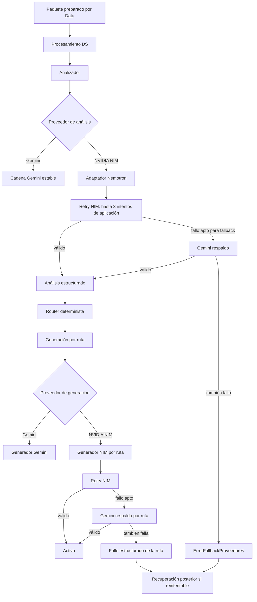

# Manual maestro de lectura del código de CommunityLab — rama NVIDIA NIM

Este documento es la guía maestra de lectura, mantenimiento y revisión de la rama
`feature/DS-Semana3-Nvidia`.

La rama parte de la línea estable de CommunityLab integrada en `develop` mediante
el PR #22 y agrega una implementación experimental de NVIDIA NIM sin reemplazar
el flujo estable de Gemini. El objetivo es poder seleccionar NVIDIA para análisis
y/o generación, conservar los contratos existentes y usar Gemini como respaldo
cuando el proveedor primario falla por causas operativas o devuelve una salida
inutilizable.

> **Fuente de verdad:** si este manual contradice al código o a las pruebas de la
> rama, prevalecen el código y sus pruebas. Las ejecuciones históricas de
> evaluación sirven para regresión/estabilidad; no deben tratarse como ground
> truth humano.

## 1. Qué cambia en esta rama

La arquitectura estable de CommunityLab se conserva. La rama NVIDIA añade cinco
capacidades principales:

1. Selección explícita de proveedor para análisis y generación.
2. Adaptador NVIDIA NIM compatible con la API estilo OpenAI.
3. Fallback controlado `NVIDIA NIM -> Gemini`.
4. Trazabilidad del proveedor usado, los retries y el motivo de fallback.
5. Recuperación posterior cuando fallan ambos proveedores y el fallo sigue siendo
   reintentable.

La arquitectura objetivo de esta rama usa **NVIDIA NIM como proveedor primario por defecto** y mantiene **Gemini como proveedor de respaldo**. Gemini continúa disponible como implementación estable, pero en esta rama su papel principal es resolver la operación cuando NIM falla por una causa apta para fallback.

### Checkpoints relevantes de la rama

| Commit | Propósito |
| --- | --- |
| `70672ef` | Sincronización de la rama NVIDIA con `develop`, preservando el endurecimiento estable y la lógica experimental. |
| `8e9ac37` | Corrige el adaptador NVIDIA para devolver la cadena estructurada ejecutable. |
| `b5408da` | Conserva la posibilidad de recuperación posterior cuando fallan ambos proveedores. |
| `3bc3296` | Correlaciona retries internos del proveedor con ID y ruta en observabilidad. |
| `f8c3056` | Extrae la política de fallback a `fallback_ia.py` manteniendo `modelo_ia.py` como fachada pública. |
| `3ae6941` | Limpieza de import duplicado en generadores. |

## 2. Ownership y contratos que no deben romperse

Esta rama pertenece principalmente al trabajo de Data Science.

- `src/datos/*` pertenece principalmente a Data Analyst. No modificar su lógica
  desde esta rama sin revisar ownership y coordinar con Data.
- `src/agentes/*` concentra la lógica de Data Science y es el área principal de
  esta rama.
- Data sigue siendo fuente de verdad de `score_relevancia`, `tipo_original`,
  `elegible_contenido` y `elegible_faq`.
- Data Science conserva `tipo_original` y produce `tipo_detectado`.
- El router continúa siendo determinista; no se usa un LLM para decidir rutas.
- `EstadoAgente`, el contrato DS 1.3, las rutas y los prompts funcionales no se
  modifican por el simple hecho de cambiar de proveedor.
- Nemotron es un modelo servido mediante NVIDIA NIM. No se trata como un
  proveedor separado.
- DeepSeek está fuera del alcance activo de esta rama.

## 3. Recorrido recomendado de lectura

Para comprender la rama sin saltar entre capas, lee en este orden:

1. `src/agentes/configuracion_ia.py`: proveedores admitidos, defaults, timeout y
   modelo NVIDIA.
2. `src/agentes/proveedores/gemini.py`: proveedor estable.
3. `src/agentes/proveedores/nvidia_nim.py`: cliente NIM y adaptación a salida
   estructurada.
4. `src/agentes/modelo_ia.py`: fachada pública de proveedores.
5. `src/agentes/fallback_ia.py`: política común NIM -> Gemini.
6. `src/agentes/cadenas.py`: cadenas de análisis individual y por lote.
7. `src/agentes/nodos/nodo_analizador.py`: análisis, lotes y aislamiento de
   estados incompletos.
8. `src/agentes/nodos/nodo_enrutador.py`: reglas deterministas de routing.
9. `src/agentes/nodos/nodos_generadores.py`: generación por ruta y fallback
   independiente.
10. `src/agentes/reintentos.py`: retry y clasificación de errores transitorios.
11. `src/agentes/recuperacion.py`: recuperación posterior de fallos.
12. `src/agentes/observabilidad.py`: correlación, callbacks y eventos.
13. `src/agentes/procesamiento.py` y `src/agentes/grafo.py`: orquestación global.
14. `tests/agents/`: pruebas offline de DS.
15. `tests/integracion/prueba_nvidia_*.py`: pruebas live explícitas.

Si necesitas comprender primero el proyecto completo y no solo el delta NVIDIA,
lee también el manual maestro estable, especialmente las secciones de Datos,
contrato de salida, routing, generación y procesamiento por lotes.

## 4. Mapa mental de la rama



La idea clave es que hay **tres mecanismos distintos**:

- **Retry:** repetir una operación contra el mismo proveedor.
- **Fallback:** cambiar de NVIDIA NIM a Gemini dentro de la misma interacción o
  ruta.
- **Recuperación posterior:** volver a procesar más tarde un análisis o una ruta
  que terminó fallida.

No deben confundirse ni fusionarse conceptualmente.

## 5. Configuración de proveedores

La configuración central está en `src/agentes/configuracion_ia.py`.

### Proveedores soportados

```text
gemini
nvidia_nim
```

El comportamiento esperado de esta rama es:

```text
Proveedor primario por defecto: NVIDIA NIM
Proveedor de respaldo:          Gemini
```

Análisis y generación siguen siendo configurables de forma independiente mediante:

```text
COMMUNITYLAB_PROVEEDOR_ANALISIS
COMMUNITYLAB_PROVEEDOR_GENERACION
```

En esta rama, si no se definen variables de proveedor, tanto análisis como
generación resuelven `nvidia_nim` como proveedor primario. Gemini permanece
disponible como proveedor seleccionable explícitamente y como respaldo automático
cuando el flujo primario es NVIDIA NIM y ocurre una causa apta para fallback.

### NVIDIA NIM

Valores vigentes:

```text
Base URL:
https://integrate.api.nvidia.com/v1

Modelo:
nvidia/nemotron-3.5-lightning-30b-a3b

Timeout por defecto:
3.0 segundos por intento

Retries internos del cliente ChatOpenAI:
0
```

El timeout se puede modificar con:

```powershell
$env:COMMUNITYLAB_NVIDIA_TIMEOUT_SEGUNDOS = "5"
```

Debe ser un número mayor que cero. Un valor inválido genera
`ErrorConfiguracionProveedor`.

### Credenciales

NVIDIA usa:

```text
NVIDIA_API_KEY
```

Gemini usa:

```text
GEMINI_API_KEY
```

Para probar el recorrido real de fallback NIM -> Gemini se necesitan ambas
credenciales.

Nunca versionar `.env`, claves ni tokens.

## 6. Proveedor NVIDIA NIM

Archivo:

```text
src/agentes/proveedores/nvidia_nim.py
```

### `obtener_modelo_nvidia()`

Construye un `ChatOpenAI` apuntando al endpoint de NVIDIA NIM.

Parámetros relevantes:

```text
temperature = 0
timeout = COMMUNITYLAB_NVIDIA_TIMEOUT_SEGUNDOS
max_retries = 0
enable_thinking = False
```

Los retries se desactivan en el cliente NVIDIA porque la política se controla en
la capa de aplicación. Esto evita sumar retries ocultos.

### `obtener_modelo_nvidia_estructurado(esquema)`

NVIDIA se utiliza en JSON mode:

```python
response_format={"type": "json_object"}
```

Antes de llamar al modelo se añade una instrucción técnica con el JSON Schema del
modelo Pydantic esperado. Esa instrucción no sustituye ni modifica el prompt
semántico de CommunityLab.

Después de recibir la respuesta:

1. se exige contenido textual;
2. se rechaza una respuesta vacía;
3. Pydantic valida el JSON contra el esquema;
4. una salida inválida se convierte en `ErrorSalidaProveedor`.

La función debe devolver esta composición:

```text
preparar entrada
    |
modelo JSON de NVIDIA
    |
validación Pydantic
```

La ausencia de ese `return` fue el defecto principal detectado durante la
revisión de integración y está corregido en esta rama.

## 7. Gemini estable

Archivo:

```text
src/agentes/proveedores/gemini.py
```

Modelo vigente:

```text
gemini-3.5-flash-lite
```

Gemini mantiene:

- `max_retries=2` en el cliente;
- rate limiter local;
- structured output nativo mediante `with_structured_output()`.

Cuando Gemini es el proveedor seleccionado directamente, sigue el flujo estable.
Cuando NVIDIA es primario, Gemini funciona como proveedor de respaldo.

## 8. `modelo_ia.py`: fachada pública

`src/agentes/modelo_ia.py` ya no contiene toda la lógica de fallback.

Su responsabilidad actual es:

- exponer la configuración no secreta del proveedor activo;
- seleccionar el adaptador estructurado de Gemini o NVIDIA;
- mantener exports públicos usados por otros módulos y por las pruebas de Data;
- reexportar `invocar_modelo_con_fallback`.

El contrato público que debe conservarse es:

```python
invocar_modelo_con_fallback(
    entrada,
    *,
    primario,
    respaldo,
)
```

Retorna:

```python
{
    "resultado": ...,
    "traza": {
        "proveedor_primario": ...,
        "proveedor_usado": ...,
        "fallback_activado": ...,
        "motivo_fallback": ...,
    },
}
```

No modificar esta firma sin coordinar con Data Analyst.

## 9. `fallback_ia.py`: política de respaldo

Archivo:

```text
src/agentes/fallback_ia.py
```

Este módulo concentra cuatro responsabilidades:

```text
_nombre_proveedor()
_causa_fallo()
_motivo_seguro_fallback()
invocar_modelo_con_fallback()
```

### Orden operativo

Cuando NVIDIA es primario:

1. intenta NVIDIA;
2. usa `ejecutar_con_reintentos()` para los retries aplicables;
3. si NVIDIA responde correctamente, termina;
4. si falla por una causa que justifica fallback, llama a Gemini;
5. si Gemini responde, la interacción se considera exitosa;
6. si Gemini también falla, lanza `ErrorFallbackProveedores`.

### Causas que activan fallback

La política reconoce, entre otras:

| Causa | Motivo seguro |
| --- | --- |
| Configuración/credencial del proveedor ausente o inválida | `configuracion_proveedor` |
| Salida inválida / parser / Pydantic | `salida_invalida` |
| `TimeoutError` | `timeout` |
| `ConnectionError` | `conexion` |
| HTTP 429 | `http_429` |
| HTTP 500/502/503/504 | `http_5xx` correspondiente |
| Clases de límite de cuota | `limite_proveedor` |
| Clases conocidas de timeout/conexión | `timeout` / `conexion` |
| `InternalServerError` | `error_servidor` |

Un `ValueError` propio de una entrada inválida no activa fallback.

### Fallback exitoso

Si Gemini responde, la salida no debe registrarse como fallo. La traza sí deja
evidencia de que se activó respaldo.

### Doble fallo

Si también falla Gemini:

```text
NVIDIA falla
    ->
Gemini falla
    ->
ErrorFallbackProveedores
```

El error conserva una traza segura con tipos y motivos, sin copiar los mensajes
crudos de los proveedores dentro de esa traza.

La propiedad `reintentable` es verdadera cuando al menos una de las causas
subyacentes se clasifica como transitoria/reintentable. Esa propiedad permite
que la recuperación posterior seleccione el ID.

## 10. Retry: misma operación, mismo proveedor

Archivo:

```text
src/agentes/reintentos.py
```

Configuración de aplicación:

```text
MAX_INTENTOS = 3
ESPERA_BASE_SEGUNDOS = 2.0
ESPERA_MAXIMA_SEGUNDOS = 30.0
```

El backoff es exponencial con jitter.

Se consideran reintentables, entre otros:

- timeout;
- conexión;
- 429;
- 500, 502, 503 y 504;
- errores de salida estructurada;
- clases equivalentes conocidas de los SDK;
- `ErrorFallbackProveedores` cuando su atributo `reintentable` es verdadero.

`ErrorConfiguracionProveedor` no se repite contra el mismo proveedor.

### Evitar multiplicación de retries

NVIDIA ya hace sus tres intentos dentro de `invocar_modelo_con_fallback()`.

Por eso:

- `nodo_analizador.py` usa `max_intentos=1` en la capa externa cuando el
  proveedor activo es NVIDIA;
- `nodos_generadores.py` hace lo mismo por ruta.

Así se evita un patrón accidental `3 x 3`.

Gemini conserva la política histórica de la aplicación y además puede tener sus
propios retries internos de cliente. Cualquier ajuste de retries debe evaluar
latencia y cuota.

## 11. Análisis individual y por lote

Archivo:

```text
src/agentes/nodos/nodo_analizador.py
```

La preparación del prompt usa:

```text
origen
canal
idioma
tipo_original
texto
```

### Estado incompleto

El análisis por lote conserva el endurecimiento de la rama estable:

- cada estado se prepara de forma independiente;
- un estado manual incompleto no invalida necesariamente todo el lote;
- `errores_preparacion` aísla los estados que no pueden prepararse;
- `ids_lote` contiene solo los mensajes preparados correctamente.

### Correlación por ID

El lote no confía en la posición de la respuesta. Los resultados se asocian por
ID.

Si un ID:

- falta;
- aparece duplicado;
- no tiene resultado utilizable;

solo ese estado puede caer al análisis individual.

### NVIDIA y outer retry

`_max_intentos_externos()` devuelve `1` cuando NVIDIA es el proveedor de
análisis porque los retries NIM ya ocurren dentro del fallback.

## 12. Routing

`src/agentes/nodos/nodo_enrutador.py` conserva las reglas deterministas.

Cambiar de proveedor no modifica las rutas.

Las decisiones de Data continúan llegando por:

```text
score_relevancia
elegible_contenido
elegible_faq
tipo_original
```

DS añade el análisis semántico y produce:

```text
sentimiento
tema_principal
subtema
tipo_detectado
```

El router combina ese resultado con las elegibilidades ya calculadas por Data.

## 13. Generación por ruta

Archivo:

```text
src/agentes/nodos/nodos_generadores.py
```

Generadores disponibles:

```text
linkedin
boletin
preguntas_frecuentes
caso_exito
insight_mejora
```

Cada ruta se ejecuta de forma independiente.

Cuando generación usa NVIDIA:

1. obtiene generador NIM de la ruta;
2. obtiene generador Gemini equivalente;
3. intenta NIM con su política de retries;
4. activa Gemini solo para esa ruta si corresponde;
5. conserva los activos exitosos de las demás rutas.

Esto es especialmente importante en multirouting: un fallo de boletín no debe
borrar un caso de éxito o una publicación LinkedIn que ya se generaron.

## 14. Recuperación posterior

Archivo:

```text
src/agentes/recuperacion.py
```

La recuperación trabaja después de que una operación terminó fallida.

`ids_reintentables()` selecciona únicamente resultados con fallos donde:

```python
fallo.get("reintentable") is True
```

Si el problema fue de análisis, se vuelve a analizar el ID.

Si el problema fue de generación, se regeneran únicamente las rutas fallidas y
se conservan los activos ya exitosos.

Por eso:

```text
retry != fallback != recuperación
```

## 15. Observabilidad

Archivo:

```text
src/agentes/observabilidad.py
```

Además del `id_ejecucion`, esta rama incorpora contexto específico de llamada IA
mediante `ContextVar`.

Campos de correlación:

```text
id_interaccion
ids_interaccion
ruta
etapa
intento
proveedor
```

Esto permite que los eventos internos de retry de NVIDIA no pierdan el ID o la
ruta que originó la llamada.

### Evento de resolución del proveedor

Después de una llamada con fallback se registra:

```text
proveedor_ia_resuelto
```

Campos relevantes:

```text
proveedor_primario
proveedor_usado
fallback_activado
motivo_fallback
id_interaccion / ids_interaccion
ruta
etapa
intento
```

### Precaución con logs

La traza pública del fallback evita copiar mensajes crudos de los proveedores.
Sin embargo, los logs técnicos de reintentos/callbacks pueden contener mensajes
de excepción y traceback.

Antes de compartir `ciencia_datos.jsonl`, revisar que no contenga información
sensible.

## 16. Errores específicos de proveedor

Archivo:

```text
src/agentes/errores_ia.py
```

### `ErrorConfiguracionProveedor`

Configuración o credencial requerida ausente o inválida.

### `ErrorSalidaProveedor`

El proveedor respondió, pero la salida no cumple el contrato esperado.

### `ErrorFallbackProveedores`

Fallaron el primario y el respaldo.

Incluye:

```text
traza
reintentable
```

No confundir `ErrorFallbackProveedores` con un retry. Representa el resultado de
haber agotado el recorrido de proveedores de una operación.

## 17. Índice de módulos clave de la rama

### Proveedores y política

| Archivo | Responsabilidad |
| --- | --- |
| `src/agentes/configuracion_ia.py` | Selección de proveedor, timeout NVIDIA, endpoint y modelo Nemotron. |
| `src/agentes/proveedores/gemini.py` | Cliente Gemini estable y structured output nativo. |
| `src/agentes/proveedores/nvidia_nim.py` | Cliente NIM, JSON mode, inyección del schema y validación Pydantic. |
| `src/agentes/modelo_ia.py` | Fachada pública y selección del adaptador estructurado. |
| `src/agentes/fallback_ia.py` | Política NIM -> Gemini y traza segura. |
| `src/agentes/errores_ia.py` | Excepciones específicas de proveedores y doble fallo. |

### Orquestación DS

| Archivo | Responsabilidad |
| --- | --- |
| `src/agentes/cadenas.py` | Cadenas de análisis y conexión del fallback para NVIDIA. |
| `src/agentes/nodos/nodo_analizador.py` | Análisis individual/lote, asociación por ID y aislamiento de errores de preparación. |
| `src/agentes/nodos/nodo_enrutador.py` | Routing determinista. |
| `src/agentes/nodos/nodos_generadores.py` | Generación por ruta, fallback independiente y preservación de rutas exitosas. |
| `src/agentes/grafo.py` | Flujo LangGraph y procesamiento por lotes. |
| `src/agentes/procesamiento.py` | Consumo del plan de Data, ciclos, pendientes y recuperación. |

### Resiliencia y seguimiento

| Archivo | Responsabilidad |
| --- | --- |
| `src/agentes/reintentos.py` | Retry, backoff, clasificación transitoria y construcción de fallos. |
| `src/agentes/recuperacion.py` | Reprocesamiento posterior de IDs/rutas fallidas. |
| `src/agentes/observabilidad.py` | Logs, callbacks, contexto de ejecución y correlación de proveedor. |

### Contratos que siguen siendo comunes

El cambio de proveedor por defecto no modifica la lógica de `src/datos/*`.
`tests/test_entrega_ia.py` debe esperar que el campo informativo
`informe["modelo_ia"]` describa NVIDIA NIM cuando no existe override de proveedor.
Ese ajuste es una expectativa de prueba sobre configuración de DS, no un cambio
de scoring, ingesta, elegibilidad ni ownership de Data.

| Archivo | Responsabilidad |
| --- | --- |
| `src/agentes/estado_agente.py` | Estado interno compartido por nodos. |
| `src/agentes/modelos.py` | Modelos Pydantic de análisis y activos. |
| `src/agentes/contrato_salida_ciencia_datos.py` | Contrato público de salida DS. |
| `src/agentes/entrega_resultados.py` | Construcción y serialización de la entrega. |

## 18. Pruebas automatizadas de DS

La suite normal es offline.

Archivos principales de `tests/agents/`:

| Archivo | Qué protege |
| --- | --- |
| `test_enrutador.py` | Reglas deterministas de routing y elegibilidades. |
| `test_evaluacion_regresion.py` | Regresión/estabilidad frente a referencias históricas. |
| `test_fallback_analisis.py` | Fallback NVIDIA -> Gemini en análisis, doble fallo y correlación de retries. |
| `test_fallback_generacion.py` | Fallback por ruta, multirouting, doble fallo y recuperación. |
| `test_observabilidad_reintentos.py` | Retry, clasificación de errores, logs y recuperación. |
| `test_procesamiento_lotes.py` | Lotes, IDs, contratos y tolerancia a respuestas parciales. |
| `test_prompts_generadores.py` | Renderizado y reglas de prompts de generación. |
| `test_proveedor_nvidia.py` | Configuración, timeout, cliente NIM y adaptador estructurado. |
| `test_seleccion_proveedor.py` | NVIDIA NIM como default de análisis/generación y selección explícita de Gemini/NVIDIA. |

La suite normal debe mantenerse completamente offline. El conteo total puede
cambiar cuando se añaden pruebas, por lo que el criterio de aceptación no es un
número fijo sino:

```text
0 failed
0 llamadas reales a proveedores durante pytest normal
subtests y tests recolectados completados
```

Para el cambio de proveedor por defecto se verificaron específicamente:

```text
test_seleccion_proveedor.py                 10 passed
test_observabilidad_reintentos.py           20 passed
aceptación DA: adaptador NVIDIA              8 passed
aceptación DA: fallback NIM -> Gemini       38 passed
```

La advertencia observada durante estas pruebas proviene de `google.genai` por
una deprecación interna de Python; no representa un fallo de CommunityLab.

## 19. Pruebas de integración live

Los archivos `tests/integracion/prueba_*.py` no son recolectados por la suite
normal de pytest.

Pruebas NVIDIA presentes:

```text
prueba_nvidia_nim_estructurado.py
prueba_nvidia_nodo_analizador.py
prueba_nvidia_analisis_lote.py
prueba_nvidia_analisis_router.py
prueba_nvidia_generacion_faq.py
prueba_nvidia_generacion_multiruta.py
```

Estas pruebas:

- realizan llamadas reales a NVIDIA NIM;
- requieren `NVIDIA_API_KEY`;
- consumen cuota;
- se ejecutan de forma explícita.

Las pruebas live históricas de Gemini permanecen separadas:

```text
prueba_paquete_completo_datos.py
prueba_entrega_resultados_funcional.py
```

No presentar una corrida offline como validación de latencia o disponibilidad
real del proveedor.

## 20. Aceptación de Data Analyst

El PR #24 de Data (`feature/jhonattan-validacion-semana3`) contiene dos suites
adicionales:

```text
tests/agents/test_adaptador_nvidia_integracion.py
tests/agents/test_respaldo_nim_gemini.py
```

Cobertura:

```text
8 casos del adaptador real con transporte sustituido
38 criterios de aceptación del fallback NIM -> Gemini
```

Estas pruebas todavía no forman parte de esta rama mientras el PR #24 no esté
fusionado en `develop`.

Como prevalidación externa, ambas fueron ejecutadas contra esta rama sin llamadas
reales:

```text
8/8 passed
38/38 passed
46/46 total
```

Eso demuestra compatibilidad con los criterios publicados por Data, pero la
integración formal debe repetirse después de que el PR #24 entre a `develop`.

## 21. Cómo seguir un fallo NVIDIA

### Caso A: NIM falla pero Gemini responde

Busca el evento:

```text
proveedor_ia_resuelto
```

Debe indicar:

```text
proveedor_primario = nvidia_nim
proveedor_usado = gemini
fallback_activado = true
motivo_fallback = ...
```

La interacción no debe terminar con un fallo únicamente porque se activó
fallback.

### Caso B: NIM y Gemini fallan

Revisa:

```text
fallos[]
```

Campos relevantes:

```text
proveedor_primario
proveedor_respaldo
fallback_activado
motivo_fallback
error_primario
error_respaldo
reintentable
```

Si `reintentable=true`, el ID puede entrar a recuperación posterior.

### Caso C: una ruta falla en multirouting

Comprueba que:

- la ruta fallida quede registrada;
- los activos de las otras rutas se conserven;
- recuperación repita solo la ruta afectada.

## 22. Qué no debes inferir

- En esta rama, NVIDIA NIM debe ser el proveedor primario por defecto; Gemini se mantiene como respaldo y como implementación estable disponible.
- Nemotron no es un proveedor independiente; es el modelo activo dentro de NIM.
- DeepSeek no forma parte del alcance activo.
- Un timeout de 3 segundos es **por intento**, no por flujo completo.
- Tres intentos NIM + fallback Gemini pueden superar ampliamente tres segundos.
- Un fallback exitoso no es un fallo final.
- Un `ErrorFallbackProveedores` no significa que deba recuperarse siempre; debe
  revisarse `reintentable`.
- Una prueba offline no certifica disponibilidad, cuota ni latencia real.
- Los snapshots históricos no son ground truth humano.
- El router no debe empezar a usar un LLM por el hecho de incorporar otro
  proveedor.
- No modificar `src/datos/*` para adaptar esta rama sin coordinación con Data.

## 23. Orden seguro para futuras modificaciones

Para un cambio en esta rama:

1. identifica si afecta proveedor, fallback, retry, recuperación u observabilidad;
2. ejecuta primero la prueba focal del módulo;
3. ejecuta las pruebas de fallback de análisis y generación;
4. ejecuta `python -m pytest -q`;
5. verifica que la suite siga siendo offline;
6. si el cambio afecta integración con Data, repite sus pruebas de aceptación;
7. solo al final considera una prueba live;
8. antes de integrar a `develop`, sincroniza nuevamente desde `develop` y repite
   la suite completa.

No sustituir una implementación estable por una experimental sin esta cadena de
evidencia.

## 24. Glosario específico de la rama

| Término | Significado |
| --- | --- |
| NIM | NVIDIA Inference Microservices; proveedor experimental usado en esta rama. |
| Nemotron | Modelo activo servido mediante NVIDIA NIM. |
| Primario | Proveedor intentado primero en una operación con fallback. |
| Respaldo | Proveedor alternativo usado cuando el primario falla por una causa permitida. |
| Retry | Repetición contra el mismo proveedor. |
| Fallback | Cambio de proveedor dentro de la misma operación. |
| Recuperación | Reprocesamiento posterior de una operación que terminó fallida. |
| Traza de proveedor | Metadatos seguros que indican qué proveedor resolvió o falló. |
| Live | Prueba que usa red, credencial real y cuota del proveedor. |
| Offline | Prueba que sustituye transporte/modelos y no debe acceder a servicios reales. |

## 25. Referencias de lectura

- `docs/manual_lectura_codigo.md`: manual maestro de la línea estable.
- `docs/guia_pruebas.md`: guía estable de ejecución.
- `src/agentes/configuracion_ia.py`: configuración vigente de proveedores.
- `src/agentes/fallback_ia.py`: política vigente de fallback.
- `src/agentes/proveedores/nvidia_nim.py`: adaptador NIM.
- `tests/agents/`: garantías offline.
- `tests/integracion/`: recorridos live explícitos.

## 26. Decisión posterior a la evaluación semántica

La integración de NVIDIA NIM quedó validada técnicamente, pero la evaluación
comparativa final no aporta evidencia suficiente para sustituir a Gemini como
proveedor principal de la línea estable.

Sobre un holdout congelado de 30 mensajes y tres corridas por proveedor,
Gemini obtuvo mejores resultados en las tres dimensiones evaluadas y en el
criterio conjunto.

Esto no modifica el objetivo de esta rama:

```text
feature/DS-Semana3-Nvidia
NVIDIA NIM = proveedor primario experimental
Gemini     = respaldo implementado

La recomendación que queda para revisión del equipo es mantener Gemini como
primario de la línea estable y estudiar NVIDIA NIM / Nemotron como posible
respaldo.
Importante:
- NVIDIA -> Gemini es el fallback actualmente implementado.
- Gemini -> NVIDIA es únicamente una propuesta futura.
- No deben confundirse los resultados semánticos con pruebas de retry,
  fallback o recuperación.
- El holdout final no evaluó comparativamente la calidad de generación de
  boletines, FAQ, LinkedIn, casos de éxito o insights.
Ver:
docs/evaluacion_proveedores_semana3.md
docs/evidencia_holdout_proveedores_semana3.json
tests/fixtures/holdout_final_analisis_semana3.json