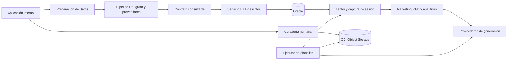

# CommunityLab: razones de arquitectura, estructura y tecnologías

**Corte de lectura: 28 de octubre de 2026.**

Este documento explica por qué la estructura actual resulta útil para el
problema de CommunityLab, qué responsabilidades separa, qué aportan sus
tecnologías y qué costos o límites introduce cada elección. Se lee junto al
[manual de código](manual_lectura_codigo.md): allí están las trazas de ejecución,
los contratos, el inventario y los ejemplos; aquí están las razones y los
compromisos. No propone una reescritura ni afirma que todo deba mantenerse igual.

## 1. Cómo leer las razones sin inventar historia

Usamos tres niveles de afirmación:

- **Hecho de implementación:** se puede comprobar en los archivos enlazados.
- **Motivo registrado:** el equipo lo expresó en documentación o decisiones
  conservadas. Puede pertenecer a una etapa anterior del producto.
- **Interpretación técnica:** explica para qué sirve el diseño observado y
  qué compromisos tiene. No significa que esa haya sido la motivación histórica
  exacta de quien lo escribió.

Salvo que se indique «motivo registrado», los beneficios y alternativas de este
documento son interpretaciones técnicas apoyadas en el comportamiento actual.
No se inventan comparativas de rendimiento ni se afirma que una tecnología
ganó un benchmark que no existe.

El objetivo de comprensión amplia no es un porcentaje medido. Al terminar,
deberías poder justificar cada capa, seguir sus dependencias y explicar qué
se rompería si se eliminara o reemplazara. La
[lista de comprobación final](#15-cómo-comprobar-que-entendiste-la-arquitectura)
permite detectar huecos.

### Índice

1. [Criterio de lectura](#1-cómo-leer-las-razones-sin-inventar-historia)
2. [Problema y restricciones](#2-el-problema-que-la-estructura-intenta-resolver)
3. [Forma arquitectónica](#3-qué-arquitectura-hay-realmente)
4. [Carpetas y dependencias](#4-por-qué-existen-estas-carpetas)
5. [Lenguaje, contratos y herramientas](#5-por-qué-estas-tecnologías)
6. [Código determinista frente a generación](#6-por-qué-no-se-delega-todo-al-modelo)
7. [Datos, contratos y almacenamiento](#7-por-qué-hay-varios-contratos-y-almacenes)
8. [Contexto, lotes y gasto](#8-por-qué-procesar-por-tokens-y-no-por-un-tope-de-registros)
9. [Citas y verificación](#9-por-qué-citas-hallazgos-y-verificación-son-cosas-distintas)
10. [Sesiones, cachés e historial](#10-por-qué-hay-estado-de-sesión-y-copias-versionadas)
11. [Publicación e idempotencia](#11-por-qué-la-escritura-es-un-servicio-separado)
12. [Contenedores y configuración](#12-por-qué-contenedores-y-configuración-externa)
13. [Pruebas y diagnóstico](#13-por-qué-probar-con-dobles-y-conservar-trazas)
14. [Límites y criterios de evolución](#14-qué-no-resuelve-esta-arquitectura-y-cuándo-reconsiderarla)
15. [Comprobación de comprensión](#15-cómo-comprobar-que-entendiste-la-arquitectura)

## 2. El problema que la estructura intenta resolver

CommunityLab convierte conversaciones heterogéneas en dos productos:

1. **Datos analizables:** sentimiento, tema, tipo, exclusión de spam y
   distribuciones para conocer la comunidad.
2. **Contenido respaldado:** activos de marketing, dudas agrupadas y borradores
   que una persona puede revisar y utilizar.

No son el mismo objetivo. Un comentario poco útil para marketing puede ser
relevante para medir sentimiento. Un conjunto con muchas preguntas no demuestra
que una misma duda se repita. Una salida con formato correcto no demuestra
que un logro descrito haya sucedido.

Las restricciones que se observan en el código son:

| Restricción | Respuesta del diseño |
| --- | --- |
| Texto y metadatos de calidad variable | Limpieza, validación, marcas de ausencia y correlación por ID |
| El modelo puede inventar o cambiar orden/formato | Esquemas, reglas locales, fuentes y revisión factual |
| Contexto y cuota externos finitos | Empaquetado, lotes, reserva de salida y límites por consulta |
| Marketing no debe escribir datos publicados | Proceso lector separado del ingestor |
| Repetir una carga no debe duplicar cifras | Transacción y recibo de huella por lote |
| La UI se vuelve a ejecutar con cada interacción | Estado de sesión, capturas y controles con claves estables |
| Las fuentes cambian entre consultas | Copias históricas por versión en el historial del chat |
| No todo éxito de una corrida implica éxito total | Fallos por etapa/ruta, recuperación selectiva e informes |
| Un activo requiere aprobación humana | Curaduría posterior al procesamiento y previa al guardado |

Estos compromisos explican mejor el proyecto que describirlo simplemente
como «un chatbot conectado a una base».

## 3. Qué arquitectura hay realmente

Hay un **núcleo Python modular**, dos entradas Streamlit y un servicio HTTP
escritor. Comparten repositorio y contratos, pero no todos se ejecutan juntos.
No es un conjunto de decenas de microservicios ni un único grafo que haga todo.

**Dos orquestaciones diferentes:**

- El [grafo DS](../src/agentes/grafo.py) analiza una interacción, elige rutas
  y genera activos. Puede comenzar con análisis ya hecho por lote.
- El [agente conversacional](../src/agentes/conversacion.py) interpreta una
  petición, busca sobre datos procesados, redacta y verifica. Se organiza con
  métodos Python; no pasa cada pregunta del usuario por el grafo DS.

Separarlos evita volver a clasificar toda la base al preguntar por datos ya
clasificados. También permite controlar la elegibilidad editorial del pipeline
sin convertir cada consulta en una nueva ingesta.

El término «frontend» en este repositorio nombra una **aplicación Python de
servidor con interfaz web**. El proceso Streamlit puede hablar con Oracle,
Vault y proveedores. El navegador no recibe por ello acceso SQL ni las claves
del proceso. Ocultar un botón tampoco constituye autorización del backend.

## 4. Por qué existen estas carpetas

| Carpeta | Responsabilidad y motivo de separación | Qué no debería confundirse con ella |
| --- | --- | --- |
| [src/datos](../src/datos/) | Normalizar fuentes, puntuar calidad/relevancia, preparar estados y proyectar el contrato consultable | Generar afirmaciones semánticas por modelo |
| [src/agentes](../src/agentes/) | Clasificación, grafos, conversación, presupuestos, recuperación y evaluación de salidas | Persistir directamente una aprobación de la UI |
| [src/agentes/nodos](../src/agentes/nodos/) | Pasos del grafo con actualizaciones parciales de estado | Pantallas o endpoints HTTP |
| [src/agentes/prompts](../src/agentes/prompts/) | Instrucciones versionables separadas del control de ejecución | Validaciones de código reemplazadas por una promesa en lenguaje natural |
| [src/agentes/proveedores](../src/agentes/proveedores/) | Detalles de cliente, muestreo y formato de cada proveedor | Decidir qué contenido es elegible para marketing |
| [src/app](../src/app/) | Experiencia de usuario, sesión, adaptación de fuentes, curaduría y catálogo | Un servicio web puramente estático |
| [src/config](../src/config/) | Adaptadores de identidad, lectura Oracle y Object Storage | Todo el estado de negocio ni solo constantes |
| [src/services](../src/services/) | Proceso HTTP que valida y escribe Oracle | Un servidor público de consultas del chat |
| [scripts](../scripts/) | Entradas operativas, demostraciones y evaluaciones explícitas | Código que deba ejecutarse al importar un módulo |
| [tests](../tests/) | Especificaciones ejecutables con fixtures, dobles y pruebas reales separadas | Evidencia automática de exactitud semántica |
| [configuracion](../configuracion/) | Parámetros versionados de relevancia | Secretos del despliegue |
| [docs](./) | Contratos, operación, decisiones y evidencia con fecha | Estado infalible de producción |

### Dependencias que conviene reconocer

La UI llama al núcleo y a adaptadores; el núcleo obtiene modelos mediante una
fachada; los adaptadores concretos contienen detalles de servicios externos.
Los prompts se combinan con esquemas, no son una capa de persistencia.
La salida DS se valida antes de convertirse en un conjunto o guardado curado.

Esta separación permite probar con un `lector`, `generador`, `verificador`,
cliente OCI o conexión Oracle inyectados. No depende de una plataforma formal
de inyección de dependencias: son parámetros y protocolos Python.

**Límite observado:** no es una arquitectura hexagonal estricta. Hay SDK,
configuración y modelos de datos compartidos por varias capas, y
[interfaz.py](../src/app/interfaz.py) y
[conversacion.py](../src/agentes/conversacion.py) concentran mucho control.
Las carpetas ayudan a navegar, pero sus nombres no garantizan desacoplamiento.

## 5. Por qué estas tecnologías

Fuentes de la lista:
[dependencias de interfaz](../requirements.frontend.txt),
[dependencias de ingesta](../requirements.backend.txt) y
[manifiesto local](../requirements.txt). Las versiones instaladas pueden
variar: varias dependencias no están fijadas y otras solo tienen mínimos.

### Lenguaje y contratos

| Tecnología | Papel comprobable | Ventaja razonable / costo |
| --- | --- | --- |
| Python | Lenguaje del núcleo, UI, scripts y servicio | Un solo ecosistema para datos e integración; el tipado requiere herramientas y validación explícitas |
| Pydantic 2 | Planes, análisis, activos, salidas y catálogo | Valida forma y restricciones al cruzar fronteras; no valida verdad factual ni elimina la necesidad de reglas cruzadas |
| `TypedDict`, `Literal` y protocolos | Estado del grafo, vocabularios y conexiones inyectables | Ayudan al editor y al lector; una anotación sola no valida un JSON recibido |
| `jsonschema` | Pruebas de contratos JSON y formatos en `test_contratos_arquitectura.py` y `test_metadatos_ausentes.py` | Permite comprobar esquemas compartibles fuera de clases Python; no implica que cada petición de producción pase por ese validador |
| JSON / UTF-8 | Intercambio, exportación, objetos y eventos | Inspeccionable y portable; menos compacto que un formato binario y necesita normalización para huellas |
| `python-dotenv` | Lectura local de configuración desde entorno/archivo | Facilita desarrollo; no es un gestor de secretos ni debe reemplazar la identidad del despliegue |

El [README](../README.md) declara Python 3.11+; las imágenes actuales usan
**Python 3.12**. Son afirmaciones diferentes: una base declarada de desarrollo
no prueba que cada versión futura esté ensayada. No debe inferirse una matriz
de compatibilidad a partir de `>=` en dependencias.

### Interfaz y análisis visual

**Streamlit** permite construir carga, tablas, chat y revisión en Python, sin
mantener un backend JSON y una SPA independientes. Es una elección coherente
con un equipo trabajando principalmente en datos e integración; esa coherencia
es una interpretación, no una comparación documentada contra React.

Su costo es el modelo de rerun: los efectos deben estar ligados a acciones
explícitas; `session_state` conserva objetos; los fragments evitan rehacer una
consulta al paginar fuentes. Los controles y su identidad forman parte del
comportamiento. No es un motor de trabajos durables ni persistencia del chat.

**Pandas** transforma resultados para tablas y cálculos de vistas;
**Altair** construye gráficos declarativos. No son el buscador de evidencia
ni el motor Oracle. Para distribuciones del chat basta `Counter`: no se
requiere pasar por un DataFrame ni pedir conteos al modelo.

**`tzdata` y `zoneinfo`** permiten representar zonas horarias en plataformas
que no aportan su base de zonas, incluido Windows. Fechas de captura,
programación y presentación no deben confundirse: una hora local visual no
cambia automáticamente la condición UTC del ejecutor.

Alternativa razonable: una SPA y una API independiente cuando se necesiten
flujos web complejos, contratos públicos o escalado separado. Sería otro
producto operativo: autenticación, sesiones, API, despliegues y pruebas
adicionales; no una mejora gratuita por usar más componentes.

### LangChain y LangGraph no cumplen la misma función

**LangChain Core** aporta plantillas de mensajes, runnables, composición
`prompt | modelo`, callbacks y salida estructurada. La
[fachada](../src/agentes/modelo_ia.py) centraliza selección de proveedor y,
en llamadas presupuestadas, autorización de consumo antes de invocar.

**LangGraph** conecta nodos de análisis, routing y generación con cortes
condicionales y estado compartido tipado. Hace explícito que un análisis
fallido termina y que sin rutas no hay generación.

Motivo registrado para separar prompts y esquemas, fallos y observabilidad:
[registro técnico](registro_cambios_y_decisiones.md). El registro es histórico;
sus apartados de estado no sustituyen el código actual.

Costo de estas bibliotecas: versiones con cambios de API, configuración de
callbacks/contexto, esquemas que el proveedor no siempre sigue y dificultad
para razonar sobre retries ocultos. Un grafo no garantiza recuperabilidad
durable: aquí no se debe asumir una base de checkpoints solo por usar LangGraph.

Alternativa: funciones y clientes HTTP directos. Simplifican una secuencia
pequeña, pero obligan a implementar composición, adaptación y trazas. El chat
ya muestra que no todo flujo del repositorio necesita ser un grafo.

### NVIDIA NIM, Gemini y el cliente compatible con OpenAI

Los adaptadores son
[nvidia_nim.py](../src/agentes/proveedores/nvidia_nim.py) y
[gemini.py](../src/agentes/proveedores/gemini.py). NVIDIA usa
`langchain-openai` como cliente compatible con su API; **eso no significa que
se esté usando un modelo de OpenAI**. Gemini usa `langchain-google-genai`.

La selección separa análisis de generación y permite modelos por tier.
En NVIDIA, FAQ/boletín, análisis y generación elaborada pueden usar modelos
distintos. El intérprete también tiene selección propia; cambiar el redactor
no implica cambiar el intérprete.

El fallback busca continuidad ante clases permitidas de error; no compara dos
respuestas para elegir la más verdadera. Cambiar de proveedor puede alterar
redacción, clasificación, latencia y costo. Los IDs de modelo son configuración,
no una revisión inmutable ni una garantía de disponibilidad futura.

Alternativa: un único proveedor para reducir complejidad operativa; pierde
respaldo y especialización. Otra alternativa es inferencia propia, que añade
hardware, operación y evaluación no presentes aquí. No se afirma cuál es más
barata sin medir volumen y calidad.

### Oracle, OCI SDK y el servidor HTTP

**`oracledb`** habla con Oracle en modo Thin para leer/escribir tablas. El
lector necesita SELECT; el escritor usa transacciones y SQL parametrizado.
El uso de SQL directo permite ver `MERGE`, bloqueos y recibos sin una capa ORM;
su costo es mantener mapeos y particularidades de Oracle manualmente.

**OCI SDK** proporciona identidad, secretos de Vault y Object Storage.
Instance Principals evita repartir una contraseña OCI estática al proceso
cuando el despliegue puede usar esa identidad; los perfiles locales siguen
disponibles explícitamente. Un OCID identifica un recurso, no contiene su
secreto. Las políticas IAM y permisos SQL siguen siendo requisitos externos.

**Motivo registrado:** el [README](../README.md) sitúa la persistencia del
proyecto en OCI y su capa gratuita. Eso documenta una orientación del proyecto,
no demuestra que todos los recursos, cuotas, proveedores o cargas sean gratis
ni que Oracle haya ganado una comparación formal contra PostgreSQL.

El ingestor usa `ThreadingHTTPServer`, `BaseHTTPRequestHandler` y JSON de la
biblioteca estándar. El manifiesto de backend es pequeño y el protocolo tiene
pocos endpoints. La sencillez reduce dependencias; también deja responsabilidades
de despliegue y acceso fuera de un framework web completo. No debe publicarse
como una API general solo porque atienda HTTP.

### Git, GitHub y documentación en Markdown

Git conserva diferencias y permite relacionar un cambio de contrato con código,
pruebas y documentación; GitHub aporta revisión e integración mediante PR.
El beneficio es trazabilidad y revisión antes de integrar, no que un merge
demuestre que producción fue desplegada o que pasó una evaluación real.
Las políticas de aprobación pertenecen a la configuración del repositorio;
no se deben inferir de un nombre de rama ni considerarse inmutables.

Markdown mantiene las guías revisables junto al código y permite enlaces
relativos y diagramas Mermaid sin duplicar la documentación en un sistema
separado. El costo es mantenerla: un índice actualizado no prueba que cada
párrafo histórico siga vigente. Por eso estas guías distinguen fecha, evidencia,
implementación actual y limitaciones.

## 6. Por qué no se delega todo al modelo

| Decisión | Quién la ejecuta | Razón técnica |
| --- | --- | --- |
| Limpieza y score de relevancia | Python y configuración | Reproducible, explicable, barato y verificable sin cuota |
| Sentimiento, tema y tipo semántico | Modelo con esquema | Requiere interpretación de lenguaje; aun así necesita evaluación |
| Elegibilidad y rutas editoriales | Reglas de Datos y enrutador | No permitir que el redactor decida permisos/cobertura por su cuenta |
| Traducción de una petición a filtros | Intérprete con `PlanConsulta` | Maneja lenguaje natural y seguimientos con contrato validable |
| Aplicación de filtros y selección | Código local | El modelo no obtiene una consola SQL ni inventa resultados de búsqueda |
| Conteos y porcentajes | Python | Usar agregados autorizados, no aritmética narrada a partir de una muestra |
| Listados literales | Python | No gastar generación ni arriesgar nombres inventados |
| Síntesis y redacción | Modelo | Es la parte generativa; se exige evidencia y límites de formato |
| Comprobaciones de ID, tamaño, plataforma y presupuesto | Python | Son invariantes medibles, no promesas del prompt |
| Respaldo semántico de afirmaciones | Otra llamada de revisión | Reduce errores del redactor, aunque sigue siendo falible |
| Aprobación editorial final | Persona / flujo de curaduría | Una validación estructural no es autorización para publicar |

La combinación es **híbrida**, no autonomía irrestricta. El usuario puede
pedir algo con lenguaje natural, pero eso no le concede cambiar el presupuesto
del servidor, ejecutar SQL, escribir en Oracle o eludir la revisión.

Una precisión importante: «análisis determinista» suele referirse a filtros,
conteos o temperatura controlada. Una llamada de modelo con temperatura cero
no debe presentarse como una función matemáticamente reproducible.

## 7. Por qué hay varios contratos y almacenes

### Contratos por responsabilidad

El lote de entrada preserva origen y contexto. El paquete de procesamiento
expresa poblaciones, ciclos y elegibilidad. El estado del grafo se actualiza
por nodos. La entrega DS expone clasificación, activos y fallos. El conjunto
plano permite consulta. El borrador conversacional representa otra salida.

Usar un único diccionario universal propagaría cambios internos y campos
irrelevantes a todos los consumidores. Las proyecciones reducen ese acoplamiento,
pero exigen mapear nombres y versiones conscientemente. Aceptar una versión
antigua no significa que deba seguir produciéndose.

Ejemplo: el nombre del tema cambia de `tema_principal` a `tema` al publicar y
vuelve a adaptarse al leer; `contenido_textual` es la columna, `texto` el campo
del agente. El autor ausente es información faltante, no un permiso para
presentar un ID como nombre.

### Almacenes con propósitos diferentes

| Lugar | Para qué sirve | Por qué no reemplaza los otros |
| --- | --- | --- |
| Oracle | Mensajes publicados consultables y metadatos/recibos de carga | No contiene todos los activos ni todo el contexto interno DS |
| Object Storage | JSON de activos aprobados y objeto del catálogo | No es una tabla consultable por filtro de sentimiento ni el chat privado |
| Archivos de `salida/` | Exportaciones, carga reintentable y logs | Dependencia del volumen/disco; no publicación automática |
| Memoria de sesión | Chat, adjuntos, captura, fuentes históricas y ediciones | Temporal y por sesión, no almacenamiento durable |
| Fixtures/snapshots versionados | Casos controlados y comparación de regresión | No reflejan necesariamente datos actuales ni verdad humana |

Oracle y Object Storage no se actualizan en una transacción distribuida. Guardar
un activo no garantiza haber publicado su mensaje en la tabla, ni viceversa.
El estado debe informarse por operación, no con un único «todo guardado».

## 8. Por qué procesar por tokens y no por un tope de registros

Veinte mensajes cortos y veinte mensajes extensos no cuestan lo mismo.
Un tope arbitrario oculta evidencia incluso cuando cabe; quitar todo límite
de contexto produciría errores o gasto imprevisible.

La solución actual separa:

1. **Selección solicitada:** cantidad del usuario o todas las coincidencias.
2. **Contexto por llamada:** instrucciones, historial, agregados, fuentes,
   esquema y salida reservada.
3. **Trabajo total de la consulta:** intentos, reservas acumuladas y admisión.

Los textos que no caben se fragmentan; los hallazgos se consolidan por niveles.
Así se intenta recorrer toda la evidencia seleccionada sin enviar un prompt
gigante. No significa salida infinita: el presupuesto puede detener la
consulta y el resumen puede omitir detalles.

La estimación por bytes UTF-8 evita depender de un tokenizador específico de
cada proveedor, pero es conservadora y no equivale a facturación. Más lotes
también significan más llamadas y etapas de revisión. La elección responde
a seguridad operativa y portabilidad, no a una medición de máxima eficiencia.

Los límites se controlan en el servidor, no en un slider público, porque el
presupuesto de gasto es una política del servicio. La cuota horaria desactivada
no se debe describir como un techo global: varias consultas sucesivas pueden
seguir gastando y varias réplicas tienen contadores separados.

## 9. Por qué citas, hallazgos y verificación son cosas distintas

- **Cita:** identifica la fuente. Validar que el ID existe evita referencias
  ajenas, pero no demuestra que esa fuente respalde el texto.
- **Hallazgo:** vincula una afirmación atómica con sus fuentes. Es la unidad
  que conserva procedencia al consolidar, no evidencia nueva.
- **Verificación:** contrasta el candidato final contra originales y agregados.
  Es otra evaluación semántica; no es una firma matemática.

Heredar todas las citas de un lote daría una apariencia de respaldo excesivo.
Por eso la procedencia se conserva por hallazgo y se expanden solo sus fuentes.
Las cantidades calculadas por la aplicación pueden tener respaldo agregado sin
un ID ficticio de mensaje.

La revisión del análisis es obligatoria porque un texto final puede exagerar
aunque sus hallazgos sean correctos. Si falla, se bloquea el análisis; no se
presenta una revisión vacía como aprobación. En borradores la revisión
automática sigue siendo un modo diferenciado de usar un prompt estricto.

La interfaz pagina fuentes para no abrir cientos de textos y permite filtrar
por afirmación/duda. **Paginar visualización no recorta la evidencia analizada.**
Un mensaje con dos dudas puede citarse en dos grupos: sumar sus frecuencias
como si fueran personas o mensajes distintos sería un error de interpretación.

## 10. Por qué hay estado de sesión y copias versionadas

La captura reduce lecturas repetidas de Oracle durante una conversación y da
un conjunto estable para una secuencia de acciones. Su costo es la frescura:
puede tener hasta una hora de antigüedad normal o más si falla la renovación,
en cuyo caso se avisa. No es una vista en tiempo real garantizada.

El historial interno del agente está acotado para no inflar prompts; el
historial visual conserva texto completo y se pagina de diez turnos. Son
propósitos diferentes. Un seguimiento lejano puede perder detalles en el
contexto del modelo aunque su respuesta siga visible.

Las fuentes históricas resuelven otra tensión: si el chat muestra siempre la
captura actual, una respuesta antigua podría parecer respaldada por texto que
no existía al responder. Se conserva una copia independiente por ID y versión
exacta, compartida entre turnos que usan la misma. Así no se repite el contenido
completo por cada respuesta igual.

La igualdad incluye metadatos; un cambio de autor también crea versión. Las
copias compartidas se tratan como solo lectura y nunca deben servir de objeto
editable de la UI. Al cambiar una fuente actual no se cambia el histórico.
Las respuestas antiguas sin copia se identifican con aviso; no se inventa una
versión pasada.

**Compromiso:** esto no es una base histórica durable ni un límite de memoria.
Las versiones nuevas y respuestas siguen ocupando espacio. Una futura solución
persistente necesitaría decidir retención, privacidad, eliminación y acceso
por usuario; agregar una tabla sin esas decisiones sería incompleto.

## 11. Por qué la escritura es un servicio separado

El límite de proceso reduce la exposición de credenciales de escritura y
concentra validación, destino y transacción en un solo camino. La app interna
llama HTTP; Marketing lee con otra identidad. Los permisos reales de Oracle
son necesarios: comprobar un nombre de usuario no concede ni revoca privilegios.

La carga es acumulativa. ID existente e idéntico es compatible con reintento;
ID existente y diferente es conflicto. Un recibo por huella distingue reintento
de carga nueva y evita duplicar el contador de spam.

Datos, metadatos y recibo se confirman juntos. El bloqueo `NOWAIT` evita
esperar indefinidamente ante otro escritor, pero serializa las cargas y puede
producir rechazo por concurrencia. Una estrategia de más throughput requeriría
replantear ese contrato, no simplemente aumentar threads.

El hash de destino ayuda a que el operador confirme dónde escribe y detecte un
cambio entre comprobación y acción. No es un token de autenticación.
`/health` solo prueba HTTP; `/destino` prueba acceso al destino; `/verificar`
compara filas. Son verificaciones con distintos alcances.

Alternativa: escritura directa desde Streamlit. Reduce un salto HTTP, pero
amplía la superficie que recibe credenciales y puede escribir. Alternativa
con cola: desacopla cargas largas, a cambio de trabajo durable, estados de
trabajo, reentrega e idempotencia adicionales. No hay tal cola hoy.

## 12. Por qué contenedores y configuración externa

Los [Dockerfiles](../Dockerfile.frontend) y el
[backend](../Dockerfile.backend) usan dos etapas con Python 3.12:
dependencias en un entorno virtual y runtime con código seleccionado. El
frontend no copia el servicio escritor; el backend copia el ingestor y su
protocolo. Ambos ejecutan con usuario no root.

Los manifiestos separados evitan instalar UI y grafos en el escritor pequeño.
El manifiesto local une ambos para trabajar y probar. No existe aquí un
lockfile que garantice idénticas resoluciones futuras de dependencias: tener
Docker no basta para llamar reproducible a cualquier reconstrucción.

[Compose](../docker-compose.yml) permite Marketing y perfiles optativos de
interno/ingesta; la entrada interna se publica en loopback y el ingestor usa
`expose`, no un puerto host en ese archivo. La red es `bridge` y se llama
`communitylab-internal`: **el nombre no equivale a declarar `internal: true`**
ni sustituye firewall, IAM, VPN o un proxy de acceso.

`security_opt` y eliminación de capabilities reducen privilegios del contenedor;
no garantizan que la aplicación tenga autenticación. Los volúmenes separan
salidas de procesos. Una copia de sesión no se vuelve durable por existir un
volumen para `salida/`.

La configuración externa separa políticas operativas de código:
proveedor/modelo, presupuestos, DSN, identificadores de secretos y destinos.
Los prompts no reciben el poder de modificar esas políticas. Los secretos no
deben copiarse a documentación, imágenes o commits; `.env.example` describe
nombres y ejemplos, no debe convertirse en una credencial compartida.

## 13. Por qué probar con dobles y conservar trazas

Los colaboradores inyectables permiten reproducir errores sin red: proveedor
que cambia IDs, presupuesto agotado, conflicto Oracle, fallo OCI, ETag distinto,
captura caducada o navegación de una página antigua.

**pytest** verifica esos contratos y **Streamlit AppTest** simula interacción
con widgets y estado. Son más útiles para estas invariantes que comprobar
únicamente que una pantalla se importa. La evaluación semántica con datos
reales sigue siendo una tarea distinta.

Los archivos `test_*.py` son la base de descubrimiento normal; algunas
integraciones `prueba_*.py` se ejecutan explícitamente y pueden gastar cuota o
escribir resultados. El nombre no reemplaza leer los efectos de la prueba.

El registro histórico explica motivos de:

- fallos estructurados, para distinguir ID, etapa y ruta;
- metadatos y fecha de referencia, para comparar corridas;
- huellas de prompt, para identificar cambios de instrucciones;
- métricas por clase, para no esconder un mal resultado en un promedio;
- regresión offline, para comparar sin volver a llamar al proveedor.

Los [eventos JSONL](../src/agentes/observabilidad.py) relacionan ejecución,
intentos, rutas y fallos. No son un sistema de cobro ni deben registrar prompts
o contenido privado completo. Un hash de prompt fija la plantilla, no la
revisión interna del modelo. Un snapshot previo mide estabilidad frente a
esa ejecución, no exactitud humana por sí solo.

## 14. Qué no resuelve esta arquitectura y cuándo reconsiderarla

| Límite actual | Cuándo conviene otro diseño | Qué habría que preservar |
| --- | --- | --- |
| Contadores por proceso y cuota horaria apagada | Varias réplicas o techo acumulado real | Reserva de cada intento, política compartida y errores explícitos |
| Chat y fuentes en sesión | Historial entre dispositivos/reinicios | Versiones, permisos por usuario, privacidad y retención |
| Consolidación potencialmente omisiva | Listados exhaustivos o auditorías | Separar extracción completa de síntesis y comprobar cobertura pedida |
| Búsqueda por tokens normalizados | Sinónimos, semántica o corpus mucho mayor | Filtros, IDs, procedencia y evaluación de recuperación |
| Base completa e índice en memoria | Volumen que exceda capacidad medida | Consistencia de agregados, selección y snapshot |
| Trabajos síncronos con servicios externos | Consultas muy largas o necesidad de continuar tras caída | Estado durable, cancelación, idempotencia y evidencia |
| Varios fallbacks/reintentos posibles | Latencia o costos mayores al objetivo | Clasificación de error y contabilidad previa |
| Dependencias sin fijación completa | Necesidad de reconstrucciones auditables | Compatibilidad y validación de versiones resueltas |
| Módulos orquestadores grandes | Cambios frecuentes que se interfieren | Límites de responsabilidad y contratos de salida |
| Revisión por modelo falible | Riesgo elevado de decisiones incorrectas | Evaluación humana, trazabilidad y no afirmar certeza absoluta |

No se añade una base vectorial, Redis, una cola o Kubernetes solo porque
existan como opciones. Se debe medir el problema, definir el objetivo y
comparar el costo operativo de la alternativa. La tecnología nueva no debe
eliminar garantías actuales para resolver un síntoma.

Tampoco hay que afirmar que la arquitectura activa automáticamente despliegue,
TLS, autenticación, políticas cloud o programación diaria. El repositorio
describe código y configuración; la ejecución real necesita verificación en el
entorno. Las pruebas offline no son una comprobación de ese entorno.

## 15. Cómo comprobar que entendiste la arquitectura

Puedes considerar cubiertos los fundamentos cuando puedas responder con
anclajes de código, no solo nombres de bibliotecas:

1. ¿Por qué se separa la población de sentimiento de la elegible para contenido?
2. ¿Por qué el chat no necesita ejecutar el grafo DS para cada consulta?
3. ¿Qué valida Pydantic que un `TypedDict` no valida en runtime y qué no puede
   validar ninguno de los dos sobre la verdad de una frase?
4. ¿Qué diferencia la función de LangGraph de la composición con LangChain?
5. ¿Por qué un cliente `langchain-openai` puede hablar con NVIDIA?
6. ¿Qué responsabilidades no debe asumir un prompt?
7. ¿Por qué Oracle no sustituye al bucket y el bucket no sustituye al índice?
8. ¿Qué costo tiene la separación lector/escritor y qué exposición evita?
9. ¿Por qué un recibo de carga necesita confirmarse junto a los datos?
10. ¿Qué se gana y qué se pierde al usar una captura por sesión?
11. ¿Por qué compartir versiones de fuentes no rompe las citas anteriores?
12. ¿Qué diferencia diez turnos visibles de seis mensajes de contexto?
13. ¿Por qué procesar todos los mensajes no demuestra exhaustividad del resumen?
14. ¿Por qué una revisión obligatoria no garantiza verdad absoluta?
15. ¿Qué habría que cambiar para soportar varias réplicas con una sola cuota?
16. ¿Qué evidencia falta antes de afirmar rendimiento, costo o calidad real?

Para cada cambio de diseño, documenta problema, decisión, alternativa descartada,
consecuencia, límites y prueba de aceptación. Si no existe evidencia de la
motivación histórica, escribe «interpretación» o «propuesta», no «se eligió
porque era la mejor».

### Lecturas para profundizar

- [Manual de código](manual_lectura_codigo.md): flujos y laboratorio offline.
- [Agente conversacional](agente_conversacional.md): búsqueda, controles y UX.
- [Contrato consultable](conjunto_consultable.md): proyección hacia consulta.
- [Sincronización DB](sincronizacion_db_ce.md): carga y compatibilidad.
- [Despliegue e identidades](docker_cloud_semana4.md): operación e aislamiento.
- [Registro técnico histórico](registro_cambios_y_decisiones.md): motivos
  registrados de etapas anteriores; comprobar vigencia contra el código.
